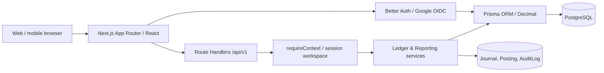

# Kiến trúc kỹ thuật đã hiện thực

## Luồng hệ thống

- Presentation: `src/app/(protected)/*`, `src/components/*`, `src/app/globals.css`; logo/icon approved trong `public/brand`.
- API: `src/app/api/v1/*`; `assertSameOrigin` trên mutations, `requireContext` mọi request, Zod validation, JSON errors nhất quán.
- P7: `requireContext(request)` thực hiện giới hạn theo user/workspace trên PostgreSQL bằng atomic UPSERT vào `ApiRateLimit`. Upload, finance writes, exports và recurring sync có quota độc lập; scheduler kiểm tra Bearer secret trước quota chung. Cấu hình Origin có hiệu lực trong cả Better Auth và API; CSP khởi đầu ở chế độ Report-Only qua Next.js headers.
- P7 tiếp theo: `limitAuthRequest()` tại Better Auth route bảo vệ POST auth và GET OAuth callback với quota global 600/phút, có thể chia IP 30/phút nếu ingress kiểm soát header tin cậy. Session polling không đếm vào quota OAuth. Báo cáo và danh sách giao dịch có quota 120/phút theo workspace; thời gian Retry-After lấy từ PostgreSQL. Quota expired có CLI cleanup riêng; bảng chỉ giữ khóa băm SHA-256.
- Application: `src/server/ledger.ts` xử lý atomic transactions và reversal; `reporting.ts` tổng hợp dữ liệu; `bootstrap.ts` khởi tạo workspace an toàn khi đăng nhập đồng thời; `categories.ts` CRUD danh mục; `seed-categories.ts` danh mục mặc định.
- Persistence: `prisma/schema.prisma`, `prisma/migrations`, PostgreSQL. Giá trị tài chính `Decimal(20,4)` từ database; API tiền là chuỗi chữ số VND.
- Identity: `src/server/auth.ts` Better Auth Google OIDC. User ID và Google providerAccountId lưu độc lập; userId không lấy từ client. `workspaceId = personal-${user.id}` gắn session. Chưa hỗ trợ nhiều workspace trên giao diện.
- Deployment: `compose.yaml` mặc định chỉ chạy PostgreSQL bind loopback cho local; profile `app` chạy image Next.js non-root và profile `release` chạy migration job riêng. Hai profile yêu cầu DSN nội bộ tường minh, không tự nhận là staging đã nghiệm thu. Xem [ADR-0006](ADR/0006-stack-runtime-and-release.md) và [deployment](DEPLOYMENT.md).

## Chốt giải pháp

1. Sổ cái kép bất biến: Journal + Posting giữ nguồn sự thật, không dùng `Wallet.balance` mutable.
2. Một tiền tệ VND trong MVP để loại trừ sai lệch tỷ giá; enum phân loại rõ các nghiệp vụ.
3. Tất cả business actions thực thi trong `prisma.$transaction`, dùng Serializable cho thao tác giao dịch.
4. Báo cáo từ Posting INCOME/EXPENSE; số dư từ Posting ASSET, bộ lọc `workspaceId`, thời điểm `effectiveAt` và ngày địa phương.
5. UI có empty state khi chưa có giao dịch; dữ liệu seed chỉ gồm danh mục (metadata), tuyệt đối không có transaction demo.

## Ranh giới và cải thiện tiếp

- Bootstrap danh mục idempotent và concurrent bootstrap đã kiểm tra trên PostgreSQL. Onboarding bước đầu tạo ví; các bước hướng dẫn thêm đang chờ UX review qua browser.
- Budget, CSV/XLSX/PDF exports, savings goals, debts, cards, net worth, recurring, CSV/XLSX import và notifications đã có service/API/UI. Service worker chỉ cache public icon/offline fallback; dữ liệu tài chính và API luôn qua network. Dark mode và mobile acceptance tiếp tục cần kiểm tra qua browser.
- Import/Recurring sử dụng `createTransactionInDb()` để ghi sổ trong cùng Prisma interactive transaction với việc cập nhật `ImportRow`/`RecurringOccurrence`; `serializable()` retry các xung đột PostgreSQL. Khóa idempotency theo source hash hoặc kỳ định kỳ đã có unique constraint theo workspace. Các test concurrent batch, failed posting và abort-after-journal chạy trên PostgreSQL; cần tiếp tục benchmark/stress nhiều instance.
- Transaction và các quan hệ nghiệp vụ P4/P5 có composite foreign key theo workspace; journal/posting đã có deferred constraint trigger tại COMMIT. Cần tiếp tục rà soát toàn bộ quan hệ, vận hành backup và kiểm thử mức tải trước production.
- Dashboard hiện tổng hợp postings INCOME/EXPENSE theo ngày và tài khoản bằng PostgreSQL `SUM/GROUP BY` tại `src/server/reporting.ts`; Node chỉ cộng các bucket đã aggregate. Số dư ví vẫn lấy từ ledger, danh sách gần đây phân trang với giới hạn 8; top expense dùng top 5 transaction. Baseline DB 10.000 giao dịch và regression 11 bộ lọc đã PASS local; SLA HTTPS nhiều replica vẫn cần T07.06d.
- Kết nối Prisma trên host Windows nên trỏ `127.0.0.1` cho cổng PostgreSQL IPv4 của Docker Desktop; `localhost` đã gây cold connect ~2 giây trong môi trường đo. `connection_limit=16` là cấu hình mẫu local, cần sizing lại theo số replica/DB ở staging.
- `includeInAvailable` đã có UI chỉnh sửa ví. Kiểm thử authenticated browser E2E còn chờ phiên Google thật.
