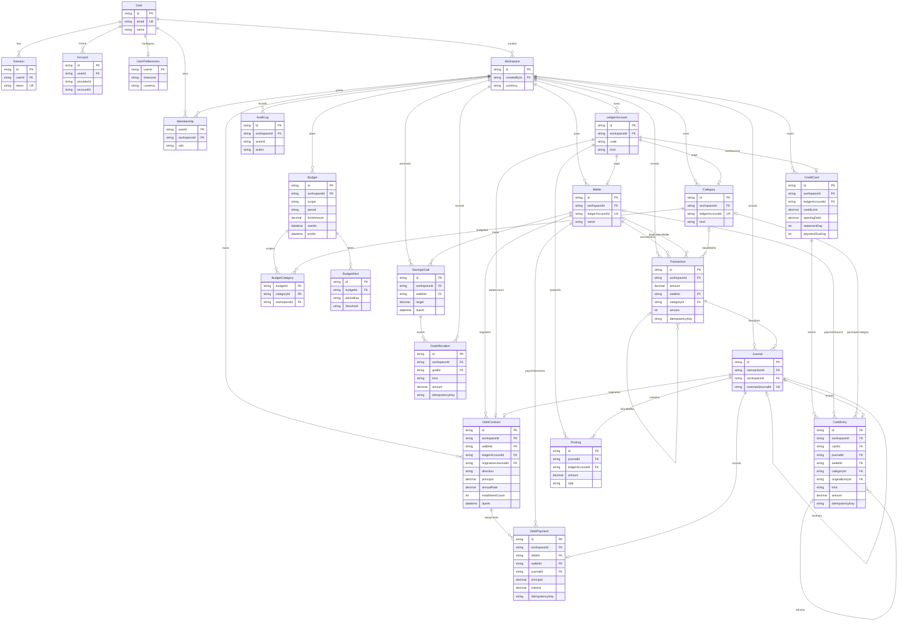

# ERD — Finova P0–P7 (PostgreSQL)

Đối chiếu `prisma/schema.prisma` và **9 migration directories** ngày 21/10/2026 (từ `20261019174000_init` đến `20261020121500_api_rate_limit`). Cột tiền là PostgreSQL `NUMERIC(20,4)`; dữ liệu nghiệp vụ ràng buộc theo `workspaceId`. Sơ đồ nêu các quan hệ chính (không thay thế định nghĩa Prisma đầy đủ). P6 có `RecurringRule`, `RecurringOccurrence`, `Notification`, `ImportBatch`, `ImportRow`; P7 thêm `ApiRateLimit`, xem schema là nguồn chuẩn cho toàn bộ FK/index.

`Verification` thuộc Better Auth và được lưu độc lập (identifier, value, expiresAt). Migration thứ hai bổ sung composite FK `(workspaceId, walletId)`, `(workspaceId, destinationWalletId)`, `(workspaceId, categoryId)`, `(workspaceId, originalTransactionId)` để PostgreSQL trực tiếp ngăn tham chiếu xuyên workspace. Composite unique `(workspaceId, id)` được tạo trên Wallet, Category, Transaction. Các unique khác: `(LedgerAccount.workspaceId, code)`, `(Category.workspaceId, kind, name)`, `(Transaction.workspaceId, idempotencyKey)`, `(Journal.reversedJournalId)`; index ngày/loại/ví phục vụ reporting. Việc kiểm tra quyền vẫn bắt buộc ở service/API.

Migration `20261019222000_deferred_journal_integrity` đã bổ sung deferred constraint trigger cấp PostgreSQL để từ chối journal thiếu posting, không cân Debit/Credit, sai loại tiền/số tiền hoặc tham chiếu sai workspace tại COMMIT; service `validateBalanced` và script `db:reconcile` kiểm tra thêm. Các quan hệ nghiệp vụ P4/P5 có composite FK `(workspaceId, id)` theo Prisma, xem migration tương ứng. Cần tiếp tục audit ràng buộc và backup/restore trước production.

**P7 — Rate limit:** `ApiRateLimit(key, windowStart, count, expiresAt)` có khóa chính ghép `(key, windowStart)` và index trên `expiresAt`. `key` là SHA-256 của loại quota + user/workspace được xác thực; không lưu định danh thô. PostgreSQL `INSERT ... ON CONFLICT ... WHERE count < limit` đảm bảo tăng bộ đếm nguyên tử giữa các instance. Migration mới `20261020121500_api_rate_limit`, không sửa các migration trước.
