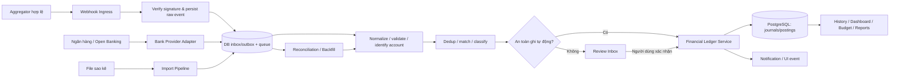
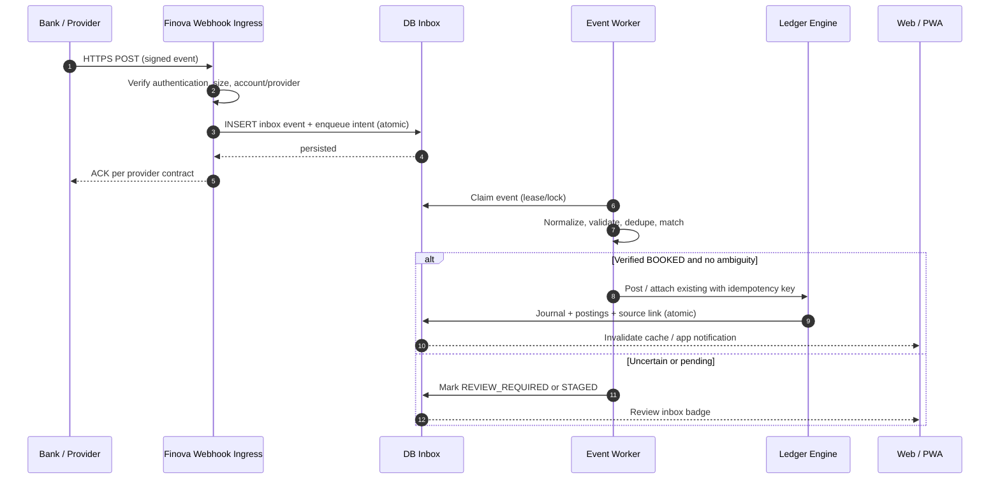

# FINOVA — ĐẶC TẢ CHỨC NĂNG ĐỒNG BỘ SAO KÊ NGÂN HÀNG

> **Mã phân hệ:** FN-BANK-SYNC  
> **Phiên bản:** 1.0 — 20/10/2026  
> **Trạng thái:** Tài liệu thiết kế, **chưa triển khai và chưa xác nhận kết nối thực tế với bất kỳ ngân hàng nào**.  
> **Sản phẩm:** Finova — *Rõ tiền, vững tương lai*  
> **Tích hợp với:** `IMPLEMENTATION_PLAN_QUAN_LY_TAI_CHINH_CA_NHAN.md`, `PROMPT_XAY_DUNG_UNG_DUNG_QUAN_LY_TAI_CHINH_CA_NHAN.md`, `FINOVA_BRAND_GUIDELINE_V2.md`.  
> **Người đọc:** Product Owner, BA, Backend, Frontend, QA, DevOps, Security, Codex/AI coding agent.

## 0. TÓM TẮT VÀ QUYẾT ĐỊNH THIẾT KẾ

**Mục tiêu:** Với những tài khoản ngân hàng mà Finova **được quyền đọc dữ liệu hợp lệ**, hệ thống nhận các biến động **tiền vào/tiền ra**, cập nhật lịch sử giao dịch, số dư và báo cáo nhanh chóng, có thể tra cứu nguồn gốc và đối soát chính xác. Độ trễ tùy ngân hàng/đối tác, không cam kết thời gian thực tuyệt đối.

**Các quyết định bắt buộc (ADR-BS):**

1. **Read-only:** phân hệ chỉ truy vấn/nhận dữ liệu giao dịch; **không** chuyển tiền, không thu OTP/mật khẩu ngân hàng, không screen-scraping, không tự động đăng nhập Internet Banking.
2. **Ngân hàng ≠ Google Login:** đăng nhập Google vào Finova chỉ chứng minh danh tính tại Finova, không cấp quyền truy cập dữ liệu ngân hàng. Phải có luồng đồng ý/ủy quyền tách biệt và phù hợp từng nhà cung cấp.
3. **Phân lớp nguồn kết nối:** `DIRECT_OPEN_BANKING`, `AUTHORIZED_AGGREGATOR`, `STATEMENT_IMPORT`. Chỉ hiển thị nút “Kết nối tự động” với ngân hàng/tài khoản đã được xác minh tích hợp hợp lệ.
4. **Bank feed không phải ledger:** dữ liệu ngân hàng nhập vào lớp staging bất biến; sau xác thực, chuẩn hóa, kiểm tra trùng và đối soát mới được phản ánh vào sổ cái kép của Finova. Không cho webhook ghi trực tiếp số dư ví hay dashboard.
5. **Nguồn gốc và chống trùng:** định danh giao dịch trên mỗi tài khoản, quy tắc idempotency, đối soát giao dịch thủ công, giao dịch định kỳ, các lần nhập tệp và các lần gửi webhook.
6. **Không biến chuyển khoản nội bộ thành thu/chi:** chuyển tiền giữa hai tài khoản của chính người dùng phải hạch toán chuyển tài sản, không làm tăng thu nhập/chi phí.
7. **Đúng trước nhanh:** hỗ trợ cơ chế “Tự động ghi nhận” với dữ liệu đủ tin cậy; đưa vào “Cần xác nhận” nếu nghi ngờ trùng, chưa xác định ví, trạng thái chưa cuối cùng hoặc có xung đột số liệu.
8. **Lỗi có thể phục hồi:** webhook lưu bền vững trước khi ACK, hàng đợi bền vững, retry an toàn, đồng bộ bù (backfill), tra soát thiếu dòng và audit.
9. **Người dùng làm chủ kết nối:** xem quyền đọc, thời hạn, tạm dừng/thu hồi, đồng bộ thủ công theo chính sách đối tác, tải/xóa dữ liệu theo chính sách hợp lệ.
10. **Không hứa hẹn phủ sóng toàn bộ ngân hàng:** danh sách, khả năng đồng bộ, phạm vi giao dịch, chi phí, độ trễ và thời gian lịch sử được kiểm chứng theo từng hợp đồng/SDK trước khi hiển thị cho khách hàng.

### 0.1. Kết quả người dùng nhìn thấy

- Sau khi có giao dịch đủ điều kiện được ngân hàng/đối tác cung cấp, dòng mới xuất hiện tại **Giao dịch → Lịch sử → Tất cả / Tiền vào / Tiền ra**.
- Hiển thị `+15.000.000 ₫` (tiền vào), `−350.000 ₫` (tiền ra), tên tài khoản, ngày giờ, nội dung gốc, danh mục gợi ý và nhãn **Đồng bộ ngân hàng**.
- Số dư ví, thu/chi tháng, ngân sách, dòng tiền, biểu đồ theo danh mục cập nhật từ **ledger** sau khi bản ghi được ghi sổ.
- Nếu là chuyển khoản giữa hai tài khoản đã liên kết của cùng người dùng, lịch sử hiển thị **Chuyển tiền nội bộ**; không cộng vào chỉ số tổng thu/tổng chi.
- Người dùng có thể sửa **danh mục, nhãn, ghi chú** mà không sửa/xóa bằng chứng giao dịch gốc từ ngân hàng.

### 0.2. Bảng phạm vi

| Tính năng | MVP (BS1–BS3) | V1 (BS4–BS5) | Nâng cao (BS6) |
|---|---|---|---|
| Import sao kê CSV/XLSX | Có | Nâng cấp | Có |
| Provider sandbox + webhook thực | Có nếu có credentials hợp lệ | Có | Có |
| Kết nối 1 ngân hàng/aggregator đầu tiên | Theo thỏa thuận, không giả lập production | Có | Có |
| Tự ghi nhận tiền vào/ra, chống trùng | Có | Có | Có |
| Đối soát giao dịch nhập thủ công | Có | Có | Có |
| Chuyển nội bộ và trạng thái cần xác nhận | Có | Có | Có |
| Quy tắc phân loại tự động | Cơ bản | Mở rộng | ML/AI sau đánh giá |
| Nhiều ngân hàng, tự làm mới consent, backfill | Nền tảng | Có theo năng lực API | Có |
| Phân tích chất lượng nguồn, chênh lệch số dư | Nền tảng | Có | Có |
| Tài khoản đồng sở hữu/gia đình | Không | Không | Theo RBAC |

> **Phụ thuộc:** Nếu không có quyền truy cập API/aggregator hợp lệ, chỉ được nghiệm thu môi trường giả lập + nhập sao kê thật do người dùng cung cấp. Không được tuyên bố “đã kết nối ngân hàng thành công”.

---

# PHẦN I — KHẢ THI KẾT NỐI TẠI VIỆT NAM

## 1. CÁC MÔ HÌNH KẾT NỐI

| Mô hình | Dữ liệu vào Finova | Ưu điểm | Hạn chế/điều kiện | Đề xuất |
|---|---|---|---|---|
| **A. Open Banking ngân hàng** | API đọc tài khoản, số dư, lịch sử, webhook nếu cung cấp | Chính thống, có định danh nguồn và luồng chấp thuận | Cần hợp đồng, onboarding TPP, môi trường test, cấu hình bảo mật; không đảm bảo mọi ngân hàng hỗ trợ cá nhân | **Ưu tiên chiến lược** |
| **B. Đơn vị trung gian có quyền kết nối** | Webhook thông báo tiền vào/ra và/hoặc API lịch sử | Có thể triển khai nhanh hơn cho ngân hàng được hỗ trợ | Kiểm tra quyền chia sẻ dữ liệu cho Finova, loại tài khoản, chi phí, truy xuất số dư/lịch sử, SLA; cần consent phù hợp | **Ứng viên triển khai sớm** |
| **C. CSV/XLSX/OFX nếu có** | File sao kê chính chủ người dùng tải lên | Khả thi không cần hợp đồng API | Không realtime; khác cấu trúc; có thể thiếu ID giao dịch; phải preview và chống trùng | **Fallback bắt buộc** |

**Không áp dụng:** BOT lấy mật khẩu, RPA đăng nhập tài khoản cá nhân, giả mạo ứng dụng ngân hàng, thu thập OTP/PIN, đọc SMS hoặc Gmail không được ủy quyền cụ thể. **VietQR tạo mã thanh toán không đồng nghĩa có API sao kê ngân hàng**; không đánh đồng các sản phẩm.

### 1.1. Bối cảnh quy định

- **Thông tư 64/2024/TT-NHNN**, hiệu lực 01/03/2025, quy định triển khai Open API ngành ngân hàng; danh mục truy vấn khách hàng có API lấy danh sách tài khoản, thông tin tài khoản và lịch sử giao dịch. Bên thứ ba sử dụng kết nối theo thỏa thuận/hợp đồng và sự đồng ý của khách hàng.
- **Luật Bảo vệ dữ liệu cá nhân số 91/2025/QH15**, hiệu lực 01/01/2026, và **Nghị định 356/2025/NĐ-CP**, hiệu lực 01/01/2026: cần đánh giá nghĩa vụ xử lý dữ liệu, sự đồng ý, vai trò các bên, vòng đời dữ liệu, chuyển dữ liệu và quyền người dùng trước khi thương mại hóa.
- Đây là **đầu mục tuân thủ để bộ phận pháp chế xác nhận**, không phải kết luận pháp lý rằng Finova được phép sử dụng bất kỳ API nào chỉ vì API được mô tả trong văn bản.

### 1.2. Nhà cung cấp và phạm vi cần xác minh

| Nguồn tham khảo công khai | Tính năng được tài liệu mô tả | Điều **chưa** được xác nhận cho Finova |
|---|---|---|
| Ngân hàng có Open API được ký hợp đồng | API consent, tài khoản, lịch sử; tùy sản phẩm có webhook | Tiếp nhận Finova dưới tư cách bên thứ ba, quyền với **tài khoản cá nhân**, mức phí, sandbox, webhook |
| **SePay** | Webhook tiền vào/tiền ra/cả hai, lựa chọn xác thực HMAC-SHA256, API Key, OAuth 2.0 | Finova có thể nhận dữ liệu cho người dùng cuối theo hợp đồng nào, ngân hàng/tài khoản cá nhân nào, giới hạn lịch sử và quyền sử dụng |
| **Casso** | Webhook V2 gửi giao dịch, xác thực chữ ký, API truy vấn giao dịch và đồng bộ | Phạm vi tài khoản cá nhân, điều kiện ủy quyền lại, chi phí và SLA cụ thể cho mô hình ứng dụng Finova |
| **ACB Developer Portal** (ví dụ ngân hàng công bố sản phẩm) | Thông tin truy vấn tài khoản, số dư, giao dịch theo sản phẩm hỗ trợ doanh nghiệp | Không suy ra tài khoản cá nhân được cấp quyền hay Finova đủ điều kiện triển khai |

**Checklist thẩm định đối tác trước khi code production:**

- [ ] Có cơ sở pháp lý/hợp đồng cho Finova nhận dữ liệu của **đúng người dùng cuối**.
- [ ] Hỗ trợ **tiền vào và tiền ra**, không chỉ thông báo thanh toán cho merchant.
- [ ] Có ID giao dịch ổn định, số tiền, đơn vị tiền, thời điểm, tài khoản, trạng thái, mô tả, running balance nếu có.
- [ ] Có webhook hoặc endpoint lịch sử + chính sách polling/backfill rõ ràng.
- [ ] Có quyền truy cập tài khoản cá nhân? Những ngân hàng nào được hỗ trợ **thực tế**?
- [ ] Có sandbox; API docs và cơ chế webhook signing; chính sách key rotation, token refresh, timeout, retry, rate limit.
- [ ] Có hướng dẫn consent/revoke, retention, bảo mật, xử lý sự cố và chi phí theo tài khoản/sự kiện.
- [ ] Xác định bên xử lý/bên kiểm soát dữ liệu, trách nhiệm hỗ trợ khi khiếu nại, xóa và khôi phục dữ liệu.

**Quy tắc UI:** danh sách `supportedBanks` lấy từ cấu hình feature flag được review, không dùng danh sách logo ngân hàng có sẵn để ngụ ý “đã hỗ trợ”.

---

# PHẦN II — NGHIỆP VỤ VÀ TRẢI NGHIỆM

## 2. USE CASE

| ID | Use case | Tác nhân | Điều kiện hoàn thành |
|---|---|---|---|
| UC-BS-01 | Xem danh sách kết nối | User | Xem ngân hàng, ví, trạng thái, lần đồng bộ, phạm vi quyền |
| UC-BS-02 | Kết nối ngân hàng | User, provider | Xác thực consent, ánh xạ tài khoản-ví, kích hoạt theo dõi |
| UC-BS-03 | Nhận tiền vào | Bank/provider, worker | Dòng thu được ghi vào lịch sử/ledger đúng danh mục |
| UC-BS-04 | Nhận tiền ra | Bank/provider, worker | Dòng chi được ghi vào lịch sử/ledger đúng danh mục |
| UC-BS-05 | Tự phân loại | Rule engine | Gợi ý/chốt danh mục theo mức tin cậy và policy |
| UC-BS-06 | Đối soát với giao dịch đã nhập | Worker/user | Liên kết một giao dịch gốc, không tạo bút toán hai lần |
| UC-BS-07 | Nhận diện chuyển nội bộ | Worker/user | Ghép giao dịch 2 đầu và không cộng thu/chi |
| UC-BS-08 | Đồng bộ bổ sung lịch sử | User, scheduler | Nhận các dòng còn thiếu trong cửa sổ hợp lệ |
| UC-BS-09 | Tạm dừng/ngắt kết nối | User | Ngừng lấy dữ liệu mới, thu hồi khi nhà cung cấp cho phép |
| UC-BS-10 | Phát hiện lệch số dư | Reconciliation worker | Báo chênh lệch, đề xuất kiểm tra, không tự sửa số dư âm thầm |
| UC-BS-11 | Nhập sao kê thủ công | User | Preview, đối soát, commit an toàn như dữ liệu từ API |
| UC-BS-12 | Xử lý hoàn tiền/đảo giao dịch | Provider, worker/user | Liên kết giao dịch gốc, hạch toán đảo đúng kỳ |
| UC-BS-13 | Xử lý sự cố và khôi phục | Admin/operator | Replay/backfill kiểm toán được; không lộ dữ liệu người khác |

## 3. CẤU TRÚC MENU

```text
Finova
├── Tổng quan
├── Giao dịch
│   ├── Tất cả giao dịch
│   ├── Tiền vào
│   ├── Tiền ra
│   └── Cần xác nhận                [badge số lượng]
├── Ví & Tài khoản
│   ├── Danh sách ví
│   ├── Tài khoản ngân hàng
│   └── Đồng bộ sao kê              [mới]
│       ├── Kết nối ngân hàng
│       ├── Lịch sử đồng bộ
│       ├── Đối soát / Chênh lệch
│       └── Quy tắc phân loại
├── Ngân sách
├── Báo cáo
└── Cài đặt
    └── Quyền truy cập dữ liệu ngân hàng
```

### 3.1. Màn hình BS-S01 — Danh sách kết nối

**Route:** `/bank-sync`.

```text
┌──────────────────────────────────────────────────────────────────────────┐
│  ĐỒNG BỘ SAO KÊ NGÂN HÀNG                       [+ Kết nối ngân hàng]   │
│  Theo dõi biến động tài khoản được bạn cấp quyền đọc                     │
├──────────────────────────────────────────────────────────────────────────┤
│  TÀI KHOẢN ĐÃ KẾT NỐI                                                 │
│  [Logo] Ngân hàng A •••• 4321    [Đang hoạt động] [Đồng bộ ngay] [...] │
│         Liên kết với ví: Ngân hàng A · Đồng bộ gần nhất: 09:52         │
│         Phạm vi: số dư / giao dịch  |  Qua: Đối tác X                  │
│  [Logo] Ngân hàng B •••• 7890    [Cần kết nối lại] [Kết nối lại]       │
│                                                                          │
│  Giao dịch mới kỳ này: 38    Cần xác nhận: 3    Chênh lệch: 1         │
├──────────────────────────────────────────────────────────────────────────┤
│  [Lịch sử đồng bộ] [Đối soát] [Quy tắc phân loại]                       │
└──────────────────────────────────────────────────────────────────────────┘
```

**Chức năng:** card mỗi tài khoản (masked), trạng thái, provider, ví gắn, mốc thời gian; menu tạm dừng/ngắt, đồng bộ lịch sử; filter và tooltip “dữ liệu có thể đến chậm”; skeleton/error/empty states; ẩn số dư theo cài đặt riêng tư. Không hiển thị toàn bộ số tài khoản nếu không cần.

### 3.2. Màn hình BS-S02 — Wizard kết nối

**Route:** `/bank-sync/connect`.

| Bước | Giao diện | Validation/điểm chặn |
|---|---|---|
| 1. Chọn ngân hàng | Tìm ngân hàng từ danh sách thực sự hỗ trợ; nhãn phương thức kết nối | Không chọn ngân hàng chưa xác minh API |
| 2. Giải thích dữ liệu | Loại dữ liệu, mục đích, đối tác nhận dữ liệu, thời hạn, lịch sử được lấy, link chính sách | Checkbox đồng ý riêng; không tick sẵn |
| 3. Ủy quyền | Redirect/consent qua host được phê duyệt (OAuth/OIDC/flow provider) | `state`, PKCE nếu phù hợp, CSRF, nonce nếu áp dụng; không nhập mật khẩu ngân hàng trong Finova |
| 4. Chọn tài khoản | Danh sách tài khoản trả về theo quyền, hiển thị masked, đơn vị tiền | Chặn tài khoản đã mapping sang ví khác gây double count |
| 5. Ánh xạ ví | Chọn ví ngân hàng Finova đã tồn tại hoặc tạo ví mới | Không tự động gộp ví khi chưa xác định chủ sở hữu/currency |
| 6. Thiết lập đồng bộ | Kỳ lịch sử ban đầu, tự ghi nhận/cần xác nhận, thông báo, phân loại | Mặc định an toàn; ngày bắt đầu phụ thuộc API; preview tác động sổ cái |
| 7. Xác nhận | Kết nối thành công; tiến độ backfill; số lượng thành công/trùng/cần xem | Chỉ xác nhận **kết nối đã hoạt động** khi provider trả bằng chứng thật |

**Tình huống ngoại lệ:** User hủy consent, token hết hạn, tài khoản chưa đủ quyền, provider không trả list, ngân hàng bảo trì, tài khoản đã liên kết chéo workspace: hiển thị trạng thái + hướng dẫn; không đánh dấu “thành công” giả.

### 3.3. Màn hình BS-S03 — Lịch sử giao dịch tự động

**Route:** `/transactions?source=bank-sync`.

```text
┌───────────────────────────────────────────────────────────────────────┐
│ LỊCH SỬ GIAO DỊCH                                                     │
│ [Tất cả] [Tiền vào] [Tiền ra] [Chuyển nội bộ] [Cần xác nhận (3)]     │
│ [Thời gian] [Ngân hàng/Ví] [Danh mục] [Nguồn] [Tìm kiếm]             │
├───────────────────────────────────────────────────────────────────────┤
│ 20/10/2026                                                            │
│ 09:36  +15.000.000 ₫  Nhận lương           [Thu nhập] [Đã đồng bộ]   │
│        Ngân hàng A ••••4321 · ND: LUONG THANG 10                     │
│ 09:22     −85.000 ₫  Cà phê               [Ăn uống] [Đã đồng bộ]   │
│        Ngân hàng A ••••4321 · ND: THANH TOAN POS...                  │
│ 08:15  −2.000.000 ₫  Chuyển sang ví B       [Chuyển nội bộ]          │
│        Ngân hàng A → Ngân hàng B · Không tính vào thu/chi            │
└───────────────────────────────────────────────────────────────────────┘
```

Số liệu **ví dụ giả lập giao diện**, không phải kết quả tích hợp thật. Filter có thể kết hợp hướng giao dịch, trạng thái, đối tác, category, tìm kiếm, ngày ghi sổ/ngày phát sinh, ký hiệu nguồn. Mỗi dòng mở `BS-S04`.

### 3.4. Màn hình BS-S04 — Chi tiết giao dịch

- **Phần ngân hàng (chỉ đọc):** số tiền có dấu, currency, tài khoản đã che số, tên ngân hàng, mô tả gốc, mã tham chiếu (mask phù hợp), thời gian giao dịch, thời gian nhận dữ liệu, trạng thái nguồn, provider, hash bản ghi.
- **Phần Finova (được chỉnh):** danh mục, tên hiển thị, merchant, nhãn, ghi chú, phân bổ danh mục (nếu hỗ trợ), đánh dấu transfer/hoàn tiền, ẩn khỏi ngân sách theo quy tắc được phép.
- **Nguồn gốc:** “Nhận qua … lúc …”, “Đã ghép với giao dịch thủ công #...”, “Lần xử lý ...”; audit changes.
- **Actions:** sửa phân loại, xác nhận, đối chiếu, báo trùng, mở lịch sử đồng bộ; không sửa số tiền, thời điểm gốc, tài khoản nguồn và mã định danh ngân hàng.

### 3.5. Màn hình BS-S05 — Cần xác nhận & Đối soát

Tabs: `Chờ gắn ví`, `Trùng tiềm năng`, `Chuyển nội bộ`, `Thiếu thông tin`, `Chênh lệch số dư`, `Lỗi đồng bộ`. Mỗi item có lý do, bằng chứng, thao tác “Liên kết với giao dịch có sẵn” / “Ghi nhận mới” / “Đánh dấu chuyển nội bộ” / “Bỏ qua có lý do”. Hành động ghi audit và chạy service nghiệp vụ trong DB transaction.

### 3.6. Màn hình BS-S06 — Lịch sử đồng bộ

Cột: nguồn; tài khoản; thời gian bắt đầu/kết thúc; kiểu chạy `WEBHOOK/POLL/BACKFILL/IMPORT/REPLAY`; số nhận; hợp lệ; mới; trùng; cần xem; lỗi; trạng thái; correlation ID (chỉ admin hoặc hiển thị rút gọn). Có “Xem lỗi” và “Đồng bộ bù” với range được provider cho phép; giới hạn lần gọi.

### 3.7. Trạng thái hiển thị

| Mã | Nhãn UI | Ý nghĩa | Hành động |
|---|---|---|---|
| `ACTIVE` | Đang đồng bộ | Consent/token hợp lệ và chưa phát hiện lỗi | Xem lịch sử/tạm dừng |
| `SYNCING` | Đang xử lý | Backfill/poll đang chạy | Theo dõi tiến độ |
| `DEGRADED` | Chậm đồng bộ | Nguồn gián đoạn hoặc dữ liệu đến trễ | Chờ/đối soát |
| `REAUTH_REQUIRED` | Cần kết nối lại | Consent/token hết hạn hoặc bị thu hồi | Kết nối lại |
| `PAUSED` | Đã tạm dừng | Người dùng chủ động dừng | Tiếp tục nếu hợp lệ |
| `ERROR` | Lỗi kết nối | Lỗi kéo dài cần xử lý | Thử lại/Trợ giúp |
| `DISCONNECTED` | Đã ngắt | Ngừng lấy dữ liệu mới | Cấp quyền lại |

Phân biệt ba lớp status: **trạng thái kết nối**, **trạng thái bản ghi nguồn** (`PENDING/BOOKED/REVERSED/UNKNOWN`) và **trạng thái ghi nhận** (`STAGED/AUTO_POSTED/MATCHED/REVIEW_REQUIRED/IGNORED/FAILED`).

---

# PHẦN III — QUY TẮC XỬ LÝ TÀI CHÍNH

## 4. CHUẨN HÓA GIAO DỊCH

### 4.1. Hợp đồng dữ liệu chuẩn nội bộ

```ts
// Đây là contract NỘI BỘ Finova, không phải schema bắt buộc của ngân hàng.
type BankDirection = 'IN' | 'OUT';
type BankBookingStatus = 'PENDING' | 'BOOKED' | 'REVERSED' | 'UNKNOWN';

type NormalizedBankTransaction = {
  provider: string;
  connectionId: string;
  providerAccountId: string;
  externalTransactionId: string | null;
  bankReference: string | null;
  amount: string;           // Số dương, decimal string; không dùng JS float
  currency: 'VND';         // Phạm vi V1: chỉ hạch toán VND
  direction: BankDirection;
  bookedAt: string | null; // ISO8601 có offset khi xác định được
  occurredAt: string;      // ISO8601 có offset
  receivedAt: string;      // ISO8601 UTC
  bookingStatus: BankBookingStatus;
  descriptionRaw: string;
  counterpartyName?: string | null;
  counterpartyAccountMasked?: string | null;
  runningBalance?: string | null;
  rawEventId: string;
  sourceVersion: string;
};
```

**Bắt buộc:** parser từng provider được kiểm thử bằng fixture thật đã khử thông tin cá nhân; xác thực loại tiền và số tiền > 0, ngày hợp lệ, timezone, hướng giao dịch rõ ràng; không đoán `IN/OUT` từ số dư sau giao dịch nếu provider không nói rõ và không có số dư trước đáng tin cậy. Nếu dữ liệu thiếu/hỏng => `REVIEW_REQUIRED` hoặc reject/quarantine.

**Thời gian:** lưu `occurredAt`, `bookedAt`, `receivedAt`, `importedAt` riêng; hiển thị mặc định múi giờ `Asia/Ho_Chi_Minh`. Dùng `bookedAt` cho sổ cái khi giao dịch `BOOKED`, trừ khi chính sách tài khoản lựa chọn khác và được ghi trong ADR.

### 4.2. Ma trận hạch toán (ledger hiện hành của Finova)

| Giao dịch nguồn | Kết quả tại Finova | Bút toán kép ý nghĩa | Thu/chi báo cáo |
|---|---|---|---|
| Lương vào ngân hàng 15m | Thu nhập/Lương | Dr Asset:Bank 15m · Cr Income:Salary 15m | +15m thu |
| Quẹt POS 85k từ tài khoản thanh toán | Chi/Ăn uống | Dr Expense:Food 85k · Cr Asset:Bank 85k | +85k chi |
| Chuyển 2m từ ngân hàng A sang B của chính mình | Transfer A→B | Dr Asset:B 2m · Cr Asset:A 2m | Không thu/chi |
| Phí chuyển khoản 5k | Chi/Phí ngân hàng | Dr Expense:Fee 5k · Cr Asset:A 5k | +5k chi |
| Nhận giải ngân khoản vay 10m | Tăng ngân hàng + tăng nợ | Dr Asset:Bank 10m · Cr Liability:Loan 10m | Không phải thu nhập |
| Trả gốc vay 2m | Giảm nợ và tài sản | Dr Liability:Loan 2m · Cr Asset:Bank 2m | Không phải chi phí |
| Lãi vay 100k | Chi phí lãi | Dr Expense:Interest 100k · Cr Asset:Bank 100k | +100k chi |
| Hoàn tiền giao dịch mua 50k | Refund liên kết chi gốc | Dr Asset:Bank 50k · Cr Expense:OriginalCategory 50k | Giảm chi ròng 50k |
| Chuyển vào tiết kiệm của mình | Transfer bank→savings | Dr Asset:Savings · Cr Asset:Bank | Không tính thu/chi |
| Nộp tiền mặt vào ngân hàng | Transfer cash→bank | Dr Asset:Bank · Cr Asset:Cash | Không tính thu/chi |
| Trả dư nợ thẻ từ ngân hàng | Settlement liability | Dr Liability:Card · Cr Asset:Bank | Không chi trùng |
| Giao dịch PENDING / nguồn mơ hồ | Staging / cần xác nhận | **Chưa ghi sổ** | Không đưa vào KPI chính thức |
| Giao dịch ngân hàng đảo/hủy | Đảo journal hoặc đánh dấu không ghi sổ | Reversal có tham chiếu journal cũ | Báo cáo điều chỉnh đúng |

**Chú ý:** Đối tác thường chỉ cung cấp **một phía** khi tiền ra khỏi ngân hàng A. Nếu phía B chưa liên kết, vẫn có thể xác nhận thủ công đó là chuyển sang ví Finova B; nếu không xác định thì để chờ xác nhận, **không tự suy luận là chi tiêu** khi có dấu hiệu rõ ràng của chuyển nội bộ.

### 4.3. Quy tắc tính số dư

- Số dư ví Finova luôn lấy từ **ledger** (hoặc balance cache đối soát từ ledger), không lấy từ tổng tất cả webhook đã nhận.
- `providerBalance` là **snapshot đối chiếu** tại một mốc có căn cứ; có thể là booked balance, available balance hoặc running balance tùy nguồn. Không coi các loại số dư là tương đương.
- Công thức đối soát với dữ liệu đủ điều kiện: `chênh lệch = số_dư_đối_chiếu_ngân_hàng − số_dư_ledger_tại_cùng_mốc`. Cần cùng currency, cùng phạm vi tài khoản, cùng trạng thái và cutoff. Không áp dụng snapshot cho giao dịch đến không theo thứ tự.
- **Lần kết nối ví đã có số dư:** xác định `cutoverAt` và `cutoverBalance` tại thời điểm chuyển quản lý; backfill trước cutoff chỉ để lịch sử hoặc phải rebuild được kiểm soát, tránh cộng lại biến động đã phản ánh trong opening balance. Không tự tăng số dư vì lấy lại lịch sử cũ.
- Nghiêm cấm ghi bút toán “điều chỉnh vô danh” để âm thầm khớp ngân hàng; chỉ tạo adjustment với lý do, xác nhận rõ ràng và audit.

## 5. CHỐNG TRÙNG (QUAN TRỌNG NHẤT)

**Ba tầng độc lập:**

1. **Event idempotency:** một thông báo webhook được gửi lặp không được xử lý nhiều lần. Khóa `(provider, connectionId, externalEventId)` nếu provider có ID sự kiện; nếu không, dùng message hash cho tầng truyền tải với TTL/kho lưu bền, không thay thế khóa giao dịch.
2. **Bank transaction idempotency:** `(providerAccountId, externalTransactionId)` unique khi có ID ổn định. Provider-specific mapping phải định nghĩa ID nào ổn định. Không dùng `bankReference` một mình trên nhiều tài khoản vì có thể trùng hoặc rỗng.
3. **Ledger idempotency:** dùng `journal.idempotencyKey = bank-sync:<canonicalBankTransactionId>:<postingVersion>`; unique theo workspace, chỉ cho tối đa **một effective journal** cho mỗi bản ghi nguồn (trừ journal reversal liên kết đúng).

**Trùng với giao dịch thủ công/file:** Matching engine tạo ứng viên theo: đúng ví + cùng hướng + cùng số tiền + thời điểm trong ngưỡng cấu hình + mô tả/mã tham chiếu/counterparty. Nếu nhiều ứng viên, hoặc độ chắc chắn chưa đạt => **yêu cầu xác nhận**; tuyệt đối không merge tự động chỉ dựa trên trùng số tiền/ngày. Với liên kết đã có, chỉ gắn `bankTransactionId` vào giao dịch sổ cái hiện hữu, không ghi lại tiền.

**Trùng xuyên nguồn:** cùng sao kê có thể đến từ API, webhook và file. Dùng matching theo bank-native ID được xác minh; nếu không có ID, chỉ gợi ý liên kết thận trọng và lưu dấu vết, không bỏ sự kiện chỉ vì cùng fingerprint. Cho phép người dùng sửa liên kết qua workflow có audit/compensating posting khi cần.

**Cạnh tranh:** dùng unique constraints + DB transaction + lock trên bank transaction/wallet khi commit, không dùng `findFirst` rồi `create` không khóa. Retry trả kết quả đã có.

## 6. PHÁT HIỆN CHUYỂN KHOẢN NỘI BỘ

- Candidate cặp A `OUT` / B `IN` nếu **cả hai là ví của cùng workspace**, VND, số tiền tương thích (cho phép phí riêng), timestamp gần nhau trong cửa sổ cấu hình, ref/counterparty hỗ trợ.
- Nếu có định danh chuyển nội bộ mạnh (matching reference/counterparty bank account đã biết) + policy cho phép: tạo một **transfer journal** và gắn **hai bank records → cùng transaction/transfer**. Không tạo income/expense.
- Nếu thiếu một chân hoặc mơ hồ: `REVIEW_REQUIRED` và đề xuất ghép; người dùng có thể chỉ định ví đích/nguồn. Đối chiếu sau này khi chân kia đến phải **gắn vào bút toán hiện có**, không ghi thêm.
- **Không** dùng tên người chuyển giống nhau làm bằng chứng duy nhất cho chuyển nội bộ.
- Khoản chuyển qua tài khoản người khác dù nội dung ghi “chuyển tiền” không tự động là chuyển nội bộ.

## 7. QUY TẮC PHÂN LOẠI TỰ ĐỘNG

Thứ tự ưu tiên:

1. Giao dịch có `userOverride` đã xác nhận: giữ danh mục của người dùng khi sync lại.
2. Rule người dùng cấu hình, ưu tiên theo `priority`, điều kiện (bank, ví, direction, amount min/max, contains text chuẩn hóa, merchant, counterparty), ngoại lệ.
3. Heuristic hệ thống (lương, chuyển nội bộ, phí, hoàn tiền) **chỉ áp dụng khi đủ bằng chứng**.
4. Nếu không nhận diện: `Chưa phân loại`, đưa vào danh sách gợi ý; vẫn có thể ghi sổ với category `Uncategorized` khi chính sách cho phép, nhưng hiển thị rõ.

**Tránh phân loại sai:** chuyển khoản có chữ `LUONG` không chắc là lương; dựa thêm payer/user rule; không tự gắn khoản vay thành lương; cho phép test rule trên lịch sử trước khi bật. Mỗi quyết định lưu `ruleId`, `ruleVersion`, `confidence`, `decisionSource`.

**Tùy chọn ghi nhận:**

- `AUTO_POST_VERIFIED`: tự ghi sổ bản ghi `BOOKED`, map chính xác account/wallet, qua idempotency và không có ứng viên trùng đáng ngờ.
- `REVIEW_FIRST`: mọi giao dịch mới vào inbox chờ xác nhận.
- `HYBRID`: tự ghi nhận khi đạt đủ điều kiện ở trên, còn lại cần xác nhận. **Khuyến nghị mặc định**.

## 8. NHẬP SAO KÊ VÀ BACKFILL

### 8.1. Import file

1. Upload file có kiểm soát định dạng/dung lượng, quét và kiểm tra tệp (CSV, XLSX; các định dạng khác chỉ thêm khi có parser chuẩn).
2. Chọn ngân hàng và ví tương ứng, xác nhận currency, timezone, cột ngày/diễn giải/thu/chi/số dư.
3. Preview trước khi ghi: `dòng hợp lệ`, `trùng đã biết`, `ứng viên giao dịch thủ công`, `cần xác nhận`, `không hợp lệ`.
4. Cho phép bỏ dòng/header, ánh xạ cột, chuẩn dấu phân cách thập phân, kiểm tra tổng tiền và ngày.
5. Confirm bằng `importJobId` + idempotency; commit từng batch có checkpoint, undo theo **compensating entries**, không xóa journal gốc.
6. Lưu fingerprint của file và dòng nguồn có scope, ngăn upload cùng file sinh giao dịch lặp. Tệp chứa dữ liệu ngân hàng nhạy cảm cần encryption/retention và xóa theo policy.

### 8.2. Backfill lịch sử tự động

- Truy vấn mốc từ `lastSuccessfulCursor` / `lastBookedAt` với **overlap window** (ví dụ đề xuất 48–72 giờ, phụ thuộc khả năng API); dùng pagination đủ trang, trạng thái job và retry từng page.
- Cho chọn từ ngày nếu provider cho phép; giới hạn khối lượng mỗi job/cửa sổ và rate-limit theo hợp đồng; xử lý thứ tự giao dịch không đảm bảo.
- Có reconciliation job định kỳ để phát hiện webhook bị bỏ lỡ, webhook lặp hoặc giao dịch đảo, không phụ thuộc chỉ vào webhook.
- Lần đầu backfill phải hiển thị **preview tác động vào số dư** và lựa chọn cutover để tránh nhân đôi opening balance.

---

# PHẦN IV — KIẾN TRÚC KỸ THUẬT

## 9. KIẾN TRÚC CÁC DỊCH VỤ



**Tech stack kế thừa:** Next.js App Router + TypeScript, PostgreSQL + Prisma, Better Auth Google, Redis + BullMQ **nếu** cần worker/queue ở quy mô nhiều tài khoản. Để giảm phụ thuộc giai đoạn đầu có thể dùng **PostgreSQL persistent queue + outbox**; không dùng in-memory queue hoặc client-only timers cho nghiệp vụ tiền.

### 9.1. Components / modules

```text
src/modules/bank-sync/
├── domain/
│   ├── bank-sync.types.ts
│   ├── bank-sync.constants.ts
│   └── matching-policy.ts
├── providers/
│   ├── bank-provider.interface.ts
│   ├── sandbox.provider.ts
│   ├── sepay.adapter.ts           # chỉ khi có hợp đồng/credentials
│   ├── casso.adapter.ts           # chỉ khi có hợp đồng/credentials
│   └── direct-openapi.adapter.ts  # theo ngân hàng thực tế
├── services/
│   ├── connection.service.ts
│   ├── consent.service.ts
│   ├── ingest.service.ts
│   ├── normalize.service.ts
│   ├── deduplicate.service.ts
│   ├── match.service.ts
│   ├── category-rule.service.ts
│   ├── accounting.service.ts
│   ├── reconcile.service.ts
│   └── audit.service.ts
├── workers/
│   ├── event.worker.ts
│   ├── backfill.worker.ts
│   ├── reconcile.worker.ts
│   └── token-refresh.worker.ts
├── repositories/
├── validators/
└── test/fixtures/              # dữ liệu giả lập/đã ẩn danh
src/app/(app)/bank-sync/
src/app/api/v1/bank-sync/
src/app/api/webhooks/bank-sync/[provider]/
```

### 9.2. Trình tự webhook → lịch sử



**ACK policy:** chỉ ACK sau khi xác thực và lưu bền vững; **không** cần chờ ledger/biểu đồ hoàn tất. Nếu chưa persist được thì trả lỗi đúng hợp đồng để provider retry. Ví dụ SePay công bố ACK với `200/201` + JSON `{"success":true}`; adapter phải trả chính xác theo contract provider, không áp một response chung cho tất cả.

### 9.3. Polling/fetch (nếu provider không có webhook)

Scheduler → tìm active connections đến lịch → acquire distributed lock per connection → refresh token nếu cho phép → fetch pages với cursor và overlap → normalize vào cùng pipeline → update watermark **chỉ khi toàn bộ phần dữ liệu cam kết xử lý đã persist** → retry rate-limited/backoff; giám sát cảnh báo stale.

### 9.4. Đồng bộ hiển thị web/app

- Sau ledger commit, cập nhật cache key theo `(workspaceId, walletId, period)`, phát SSE/WebSocket nếu hạ tầng hỗ trợ; fallback refetch/poll frontend khi tab đang mở.
- Thông báo push tùy opt-in, mặc định nội dung riêng tư: “Có giao dịch mới” khi thiết bị khóa; hạn chế đẩy số dư đầy đủ qua payload push.
- **Không dùng** `localStorage` hoặc Service Worker cache để lưu raw sao kê/token; yêu cầu session hợp lệ mọi lần xem chi tiết.

## 10. THIẾT KẾ CƠ SỞ DỮ LIỆU (MỞ RỘNG, KHÔNG THAY LEDGER)

Giữ nguyên `users`, `workspaces`, `wallets`, `transactions`, `journals`, `postings`, `import_jobs` từ Implementation Plan trước. Bổ sung:

| Bảng | Trường quan trọng (ngoài id, timestamps) | Ràng buộc/ghi chú |
|---|---|---|
| `bank_providers` | `code`, `displayName`, `status`, `capabilitiesJson`, `configVersion` | Quản lý backend, không mặc định mọi ngân hàng hoạt động |
| `bank_connections` | `workspaceId`, `providerId`, `providerConnectionRef`, `status`, `consentId`, `consentExpiresAt`, `lastSyncedAt`, `errorCode`, `pollCursor`, `credentialRef` | Credential pointer tới vault/encrypted store, không plain tokens; mỗi workspace scope |
| `bank_consents` | `connectionId`, `scopeJson`, `consentArtifactRef`, `grantedAt`, `expiresAt`, `revokedAt`, `purposeVersion` | Lưu bằng chứng quyền truy cập, không lưu nội dung bí mật trong log |
| `bank_accounts` | `connectionId`, `workspaceId`, `providerAccountRef`, `bankCode`, `accountMasked`, `accountIdentifierHash`, `currency`, `walletId`, `status` | UNIQUE(connectionId, providerAccountRef); `walletId` kiểm soát 1 active mapping nguồn phù hợp; ownership verification |
| `bank_raw_events` | `providerId`, `connectionId`, `externalEventId`, `payloadCipherRef`, `payloadHash`, `signatureValid`, `receivedAt`, `processingStatus`, `attemptCount` | UNIQUE(providerId, connectionId, externalEventId) khi có ID; raw encrypted, hạn lưu theo policy |
| `bank_transactions` | `workspaceId`, `bankAccountId`, `externalTransactionId`, `bankReference`, `direction`, `amount`, `currency`, `occurredAt`, `bookedAt`, `descriptionRaw`, `runningBalance`, `bookingStatus`, `processingStatus`, `rawEventId`, `fingerprint`, `sourceVersion` | UNIQUE(bankAccountId, externalTransactionId) khi non-null; immutable source attributes/version snapshots |
| `bank_transaction_links` | `bankTransactionId`, `transactionId`, `linkType`, `createdBy`, `createdAt`, `linkStatus` | UNIQUE(bankTransactionId, transactionId); cho phép 2 bank records → 1 transfer; kiểm soát các liên kết hiệu lực |
| `bank_match_candidates` | `bankTransactionId`, `candidateTransactionId`, `score`, `reasonsJson`, `status` | Lưu giải thích, không tự merge nếu thiếu định danh |
| `bank_category_rules` | `workspaceId`, `priority`, `conditionsJson`, `categoryId`, `enabled`, `ruleVersion`, `createdBy` | Luật có owner, order và audit; không chạy regex mất kiểm soát |
| `bank_sync_jobs` | `connectionId`, `bankAccountId?`, `type`, `status`, `fromAt`, `toAt`, `cursor`, `startedAt`, `endedAt`, `metricsJson`, `failureReason` | UNIQUE active job per connection+scope để ngăn chạy chồng |
| `bank_reconciliation_snapshots` | `bankAccountId`, `asOfAt`, `balanceType`, `bankBalance`, `ledgerBalance`, `delta`, `status`, `resolvedBy` | Không tự thêm adjustment; nguồn snapshot có bằng chứng |
| `bank_review_items` | `workspaceId`, `bankTransactionId`, `reasonCode`, `suggestionJson`, `status`, `resolvedBy`, `resolvedAt` | UNIQUE active review per bank tx + reason |
| `bank_audit_events` | `workspaceId`, `actorType`, `actorId`, `action`, `resourceType`, `resourceId`, `metadataRedactedJson`, `occurredAt` | Append-only; không log full token/số tài khoản |
| `bank_sync_outbox` | `eventType`, `aggregateId`, `payloadRef`, `status`, `nextAttemptAt`, `retryCount` | DB transactionally persisted với inbox/ledger events |

### 10.1. Quy tắc schema bắt buộc

- Tất cả bảng có FK đúng owner/workspace; mọi query người dùng **phải** đi qua scope quyền. Provider callback lấy `connectionId` từ mapping bảo mật ở server, không tin `workspaceId` trong webhook body.
- Tiền dùng PostgreSQL `NUMERIC(20,4)`/Prisma Decimal, API serialize bằng **string**; VND validate số nguyên. Không float; tiền nhận từ provider bằng JS number chỉ parse an toàn nếu nằm trong giới hạn integer và rõ unit.
- Bank transaction source không được sửa khi user đổi category. Lưu user metadata ở `transactions`/bảng phụ.
- Index gợi ý: `(workspaceId, occurredAt DESC)`, `(bankAccountId, bookedAt DESC)`, `(processingStatus, receivedAt)`, `(connectionId, lastSyncedAt)`, unique external IDs.
- Ngắt kết nối **không cascade delete** journal đã ghi: người dùng vẫn cần lịch sử và chứng cứ đối soát; xóa theo yêu cầu phải tuân thủ chính sách bảo vệ dữ liệu và nghĩa vụ lưu trữ hợp lệ.
- Dùng journal reversal cho rollback, không `DELETE`/`UPDATE` postings đã posted; không đăng ký unique kiểu “một giao dịch ngân hàng chỉ liên kết một dòng” vì transfer hai nguồn hoặc split liên quan nhiều dòng.

### 10.2. Migration theo phiên bản

`M-BS01` provider + connection + consent + account mapping → `M-BS02` raw event + canonical bank tx + unique indexes → `M-BS03` source links + review + audit → `M-BS04` sync jobs + reconciliation + outbox + rules. Dùng migrations có rollback strategy, backfill schema từ ví ngân hàng hiện có **không** tự nối sang tài khoản bên ngoài.

## 11. PROVIDER ADAPTER CONTRACT

```ts
interface BankProviderAdapter {
  readonly providerCode: string;
  readonly capabilities: {
    accountList: boolean;
    transactionHistory: boolean;
    balance: boolean;
    webhook: boolean;
    tokenRefresh: boolean;
    personalAccounts: boolean | 'UNVERIFIED';
  };
  createAuthorization?(input: AuthorizationRequest): Promise<AuthorizationResult>;
  exchangeAuthorizationCode?(input: CallbackRequest): Promise<ConnectionResult>;
  refreshAuthorization?(connection: BankConnection): Promise<void>;
  revokeAuthorization?(connection: BankConnection): Promise<void>;
  listAccounts?(connection: BankConnection): Promise<ExternalBankAccount[]>;
  listTransactions?(query: BankTransactionQuery): Promise<BankTransactionPage>;
  getBalance?(account: BankAccount): Promise<BankBalanceSnapshot>;
  verifyWebhook(request: { rawBody: Uint8Array; headers: Headers }):
    Promise<VerifiedWebhookEnvelope>; // fail closed
  normalizeTransaction(payload: unknown): NormalizedBankTransaction[];
}
```

Không tất cả provider có OAuth: `createAuthorization`, `listTransactions`, `getBalance` có thể không hỗ trợ; capability thực tế quyết định UI. Với webhook aggregator, quyền kết nối/cấp consent có thể diễn ra ở portal của đối tác; **Finova phải chứng minh dữ liệu người dùng được ủy quyền hợp lệ**, không tự nhận webhook toàn bộ tài khoản của một merchant vào workspace cá nhân khác.

## 12. REST API (ĐỀ XUẤT, KHÔNG PHẢI API NGÂN HÀNG)

**Base path** `/api/v1/bank-sync`. Tất cả API trừ inbound webhook yêu cầu auth, CSRF protection cho mutations, workspace access check, rate limit và audit.

| Method | Endpoint | Ý nghĩa | Lưu ý |
|---|---|---|---|
| `GET` | `/providers` | Ngân hàng/phương thức được xác minh hỗ trợ | Không trả credentials |
| `GET` | `/connections` | Danh sách kết nối người dùng | Có status, masked |
| `POST` | `/connections/initiate` | Tạo phiên consent/authorization | Anti-CSRF state, nonce/PKCE khi có |
| `GET` | `/connections/callback` | Nhận redirect consent | Kiểm tra state, session, callback origin |
| `GET` | `/connections/:id/accounts` | Liệt kê tài khoản trong connection | Chỉ sau khi consent hợp lệ |
| `POST` | `/connections/:id/accounts/:accountId/link-wallet` | Ánh xạ ví | Idempotency-Key |
| `PATCH` | `/connections/:id/settings` | Đổi auto-post/notify/poll policy | Cần owner |
| `POST` | `/connections/:id/pause` | Tạm dừng | Audit |
| `POST` | `/connections/:id/resume` | Tiếp tục | Kiểm tra consent |
| `DELETE` | `/connections/:id` | Ngắt + revoke khi được hỗ trợ | Không xóa dữ liệu lịch sử âm thầm |
| `POST` | `/connections/:id/sync` | Sync/backfill nếu provider cho phép | Rate-limit, async job, 202 |
| `GET` | `/sync-jobs` | Lịch sử job | Cursor pagination |
| `GET` | `/sync-jobs/:id` | Thống kê job chi tiết | Scope |
| `GET` | `/transactions` | Canonical bank transactions | Filter/status/pagination |
| `GET` | `/transactions/:id` | Chi tiết nguồn và ledger link | Mask dữ liệu nhạy cảm |
| `GET` | `/reviews` | Các trường hợp cần xác nhận | Filter reason |
| `POST` | `/reviews/:id/resolve` | Match/post/ignore/mark-transfer | Idempotency-Key, version check |
| `GET` | `/reconciliations` | Chênh lệch và snapshot | As-of, wallet |
| `GET/POST` | `/rules` | Xem/thêm luật | Validate regex/priority |
| `PATCH/DELETE` | `/rules/:id` | Sửa/tắt luật | Rule version |
| `POST` | `/imports/preview` | Xem trước CSV/XLSX | Chưa post ledger |
| `POST` | `/imports/:id/commit` | Ghi nhận file hợp lệ | Idempotent |
| `POST` | `/imports/:id/cancel` | Hủy job chưa post | Không xóa posted journal |

**Inbound endpoint (công khai về mạng, không công khai về quyền):** `POST /api/webhooks/bank-sync/:provider` — verify theo contract provider bằng nguyên bản raw body, nhận dạng connection, ghi inbox, ACK; **không lấy user/workspace từ body và tin ngay**.

### 12.1. Ví dụ response lịch sử

```json
{
  "items": [
    {
      "id": "btx_example_001",
      "walletId": "wallet_example_a",
      "bankName": "Ngân hàng A",
      "accountMasked": "••••4321",
      "direction": "IN",
      "amount": "15000000",
      "currency": "VND",
      "description": "LUONG THANG 10",
      "occurredAt": "2026-10-20T09:36:00+07:00",
      "bookingStatus": "BOOKED",
      "processingStatus": "AUTO_POSTED",
      "category": {"id": "salary", "name": "Lương"},
      "ledgerTransactionId": "txn_example_001",
      "source": "BANK_SYNC",
      "requiresReview": false
    }
  ],
  "nextCursor": null
}
```

**Ví dụ minh họa, không phải dữ liệu thật.** Kết quả thực phải được lấy từ DB của workspace sau kiểm tra quyền.

### 12.2. Lỗi API thống nhất

`401` không có session; `403` không đủ quyền; `404` resource không thuộc scope; `409` conflict/mapping trùng/job đang chạy; `422` trạng thái giao dịch không cho ghi sổ/validation; `429` rate-limit; `502/503` provider bất khả dụng. Trả `{code,message,correlationId,details?}` và **không lộ** token, số tài khoản, raw payload.

## 13. QUY TRÌNH XỬ LÝ WEBHOOK — PSEUDOCODE

```text
handleWebhook(provider, rawBody, headers):
  1. enforce HTTPS, body size limit, content type, throttling
  2. adapter.verifyWebhook(rawBody, headers)  // fail-closed; never unauthenticated
  3. map verified sender/provider account to ONE authorized connection
  4. verify connection active, consent valid, account permitted
  5. inside database transaction:
       insert bank_raw_events with event idempotency key (ON CONFLICT: increment delivery count)
       insert durable processing intent/outbox if genuinely new
     commit
  6. respond provider-specific acknowledgement quickly

processBankEvent(eventId):
  1. claim with lease and retries
  2. normalize rows, validate immutable fields and source status
  3. for each row: UPSERT canonical bank_transactions by provider-specific identity
  4. check same-source idempotency and cross-source/manual matching candidates
  5. if PENDING, no mapping, ambiguity or mismatch -> create review/staging
  6. else call existing ledger service with deterministic idempotency key
       [bank source link + journal + postings + outbox] in one atomic DB transaction
  7. record outcomes, update job metrics, notify UI
  8. on failure -> retry with exponential backoff + jitter; after max -> DLQ/review

reconcile(connection):
  1. fetch recent history and snapshots if provider permits
  2. insert any missing canonical transactions via the same pipeline
  3. compare ledger at compatible as-of cutoffs
  4. flag differences; do not silently adjust balances
```

**Bảo mật chữ ký:** không tự invent thuật toán/header tên nhà cung cấp; implement xác minh từ tài liệu chính thức và test vectors. Với provider hỗ trợ HMAC có timestamp, kiểm tra timestamp window/replay và so sánh constant-time trên raw bytes. Với static secret/API key, so sánh constant-time, rotate định kỳ, bổ sung allowlist IP theo provider khi phù hợp; không dùng tùy chọn `no authentication`.

---

# PHẦN V — BẢO MẬT, QUYỀN RIÊNG TƯ, VẬN HÀNH

## 14. THREAT MODEL TỐI THIỂU

| Rủi ro | Biện pháp chặn | Test |
|---|---|---|
| Webhook giả tạo giao dịch | Verify chữ ký/secret; mapping authorized connection; reject fail-closed | Fake signature không tạo ledger |
| Replay webhook | Unique event + bank tx + journal key, database constraints | Gửi 100 lần vẫn ghi 1 lần |
| User A truy cập sao kê User B | Workspace scope ở query/service/DB policies nếu có | IDOR tests mọi endpoint |
| Token/secret lộ | KMS/vault/encryption at rest, server-only; log scrub, rotation | Secret scanning; không xuất trong API |
| Import độc hại / CSV injection | Tệp được kiểm soát, CSV escaping khi export, chặn formula injection | File malicious không ghi sổ |
| Consent hết hạn/thu hồi | Dừng fetch, đánh dấu reauth, revoke upstream nếu có | Không lấy tiếp sau khi revoke |
| Giao dịch sai vì out-of-order | Transaction identity + booked status + reconciliation cutoff | Đảo thứ tự sự kiện vẫn đúng |
| Hạ tầng gián đoạn | Durable inbox/outbox, retry, DLQ, backfill | Kill worker giữa commit không trùng |
| Dữ liệu nhạy cảm trong push/log | Mask account, giới hạn notification content, structured redaction | Audit payload không chứa full account/token |
| Kết nối giả bằng Google | Consent ngân hàng riêng, return state/callback validation | Google login không đọc được tài khoản |
| Lạm dụng webhook gây nghẽn | Rate/size limits, quotas, request timeout, queue isolation | Spike load không làm sập app |

### 14.1. Consent và xử lý dữ liệu

Consent screen giải thích: ngân hàng/đối tác nào cung cấp dữ liệu; Finova nhận dữ liệu gì (metadata tài khoản, lịch sử, số dư nếu có); mục đích hiển thị/phân tích; phạm vi thời gian; tần suất; thời hạn; cách thu hồi; quyền của người dùng; chính sách lưu giữ/xóa. Lưu version bằng chứng consent, scope, thời điểm, provider ref.

**Minimization:** chỉ lấy các trường phục vụ đối soát và phân loại; dữ liệu đối tác (tên người chuyển/nhận, tài khoản đối ứng) xử lý theo nhu cầu nghiệp vụ, mask trong UI, mã hóa lưu trữ; tránh phân tích nhạy cảm vượt mục đích đăng ký.

**Lưu trữ/xóa:** thời hạn raw event, giao dịch, audit và backup phải được chốt theo pháp chế/hợp đồng; tách cơ chế `revoke access`, `disconnect`, `request deletion`. Không nêu thời gian xóa cứng khi chưa xác định nghĩa vụ lưu trữ. Có quy trình export dữ liệu người dùng và xử lý yêu cầu quyền dữ liệu cá nhân.

### 14.2. Quyền truy cập và admin

- User chỉ được quản lý connection của workspace mình; future family workspace áp dụng quyền `OWNER/EDITOR/VIEWER` rõ ràng; chỉ owner thực hiện consent/revoke khi chủ tài khoản chấp thuận phù hợp.
- Admin vận hành không có quyền mở mặc định sao kê chi tiết của người dùng; “break glass” có phê duyệt, lý do và audit nếu bắt buộc.
- Service account/provider worker dùng quyền tối thiểu; tách signing keys theo môi trường và đối tác, rotation.

## 15. SLO/SLA/KPI ĐỀ XUẤT (KHÔNG PHẢI CAM KẾT NHÀ CUNG CẤP)

| Chỉ số nội bộ | Mục tiêu thiết kế | Điều kiện đo |
|---|---|---|
| Tiếp nhận webhook hợp lệ | p95 < 1 giây (persist + ACK), cần phù hợp timeout provider | Từ khi Finova **nhận**, không phải lúc ngân hàng phát sinh |
| Xử lý đến ledger | p95 < 30 giây sau event hợp lệ đã nhận | Ngoại trừ review, outage, queue backlog |
| Đồng bộ bù | Theo hạn mức API, kiểm tra một vài lần/ngày tùy provider | Không claim near-realtime nếu chỉ polling |
| Dòng dữ liệu bị trùng gây ghi ledger | 0 (điều kiện invariant) | Test replay + concurrency + reconciliation |
| Dữ liệu sai workspace | 0 (điều kiện bảo mật) | Automated isolation tests |
| Hỗ trợ tái xử lý | Có retry + DLQ + admin replay với audit | Không tạo ghi sổ trùng |
| Giao dịch thiếu | Có cảnh báo lệch count/range so với API lịch sử | Độ đầy đủ phụ thuộc khả năng fetch của nguồn |
| Tình trạng kết nối | Thời điểm `lastSyncedAt`, lag quan sát, lỗi gần nhất | UI giải thích khác biệt last webhook vs last poll |

**Metrics:** webhook accepted/rejected by reason; queue lag; normalization failures; dedup rate; match rate; review backlog; per-bank stale count; sync job duration; provider rate-limit responses; reconciliation delta; orphaned records; auth consent revocations. Dashboard vận hành chỉ chứa dữ liệu tối thiểu và che thông tin tài khoản.

## 16. NOTIFICATION VÀ UI/UX THEO FINOVA BRAND GUIDELINE V2

- **Primary** xanh thương hiệu (theo V2 tokens), **Secondary** xanh ngọc; nền sáng, card bo tròn, nhiều khoảng trắng, typography Plus Jakarta Sans / Be Vietnam Pro.
- Nhãn **Đã đồng bộ** dùng biểu tượng liên kết ngân hàng; nhãn **Cần xác nhận** dùng neutral/amber hợp chuẩn WCAG; **Lỗi** dùng red + chữ rõ, không chỉ phân biệt bằng màu.
- `+` tiền vào (xanh thành công), `−` tiền ra (màu trạng thái chi tiêu); mọi màn hình dùng **đơn vị VND**, phân cách hàng nghìn Việt Nam; date dd/MM/yyyy.
- Không phân loại màu xanh cho khoản vay vào như “thu nhập”, dù dòng tiền `IN` có thể dương.
- Có chế độ ẩn số dư và nội dung sensitive; tối ưu màn 360px trở lên; ưu tiên truy cập bằng bàn phím, aria-label; có empty/loading/error states.
- Toast sau nhận dữ liệu: “Đã cập nhật 2 giao dịch mới”; lỗi: “Kết nối tạm gián đoạn. Giao dịch có thể đến chậm”; review: “Có 3 giao dịch cần kiểm tra”. Không tạo thông báo push giả khi chưa có hệ thống push.

---

# PHẦN VI — KẾ HOẠCH TRIỂN KHAI CHO CODEX

## 17. IMPLEMENTATION PLAN — 6 SPRINT / 45 TASKS

> Ước lượng **theo sprint chức năng**, không cam kết ngày hoàn thành; chỉ đánh dấu `[x]` khi có mã nguồn + test và log bằng chứng. Mọi sprint có migration, API, UI, test, security review, tài liệu. Phụ thuộc vào access provider thật được đặt rõ.

### BS0 — Discovery, hợp đồng, quyết định nghiệp vụ (6 tasks)

- [ ] **BS0-01** Khảo sát repository hiện tại, đọc Master Prompt/Implementation Plan/Brand Guideline; xác nhận kiến trúc ledger và models thực tế.
- [ ] **BS0-02** Rà soát provider khả thi: quyền kết nối tài khoản cá nhân, API inbound/outbound, consent, chi phí, coverage, SLA; lập provider comparison sheet **có dẫn nguồn**.
- [ ] **BS0-03** Chốt data contract, lifecycle statuses, source-of-truth, cutover, strict financial invariants, policy auto-post/review và ADR.
- [ ] **BS0-04** Review bảo mật/pháp chế (TT64/2024 và quy định bảo vệ dữ liệu cá nhân áp dụng); scope consent và quyền xóa/retention.
- [ ] **BS0-05** Thiết kế wireframe 6 màn hình, error/empty/mobile states, đối chiếu V2 brand tokens.
- [ ] **BS0-06** Lập thử nghiệm sandbox & dữ liệu fixture, không sử dụng mật khẩu/OTP ngân hàng thật, xác định gate production.

**Gate G-BS0:** Có ít nhất 1 đường vào dữ liệu được thiết kế đúng (sandbox hoặc import), mô hình trust/ledger được duyệt; **không** yêu cầu có ngân hàng thật để hoàn thành discovery.

### BS1 — Data foundation & import pipeline (9 tasks)

- [ ] **BS1-01** Tạo migrations `bank_providers`, `bank_connections`, `bank_consents`, `bank_accounts` và workspace scoped FK.
- [ ] **BS1-02** Tạo `bank_raw_events`, `bank_transactions`, unique indexes, `sourceVersion` và append-only policies.
- [ ] **BS1-03** Tạo `bank_transaction_links`, `bank_review_items`, audit, reconciliation snapshots, outbox.
- [ ] **BS1-04** Viết bank normalized DTO + Zod validation + parse money/time/date deterministic.
- [ ] **BS1-05** Viết import CSV/XLSX adapter có file validation, mapping wizard, preview và report dòng lỗi.
- [ ] **BS1-06** Chống trùng nội bộ file/provider; matching engine đối soát giao dịch thủ công (manual/import).
- [ ] **BS1-07** Tích hợp ledger service hiện hữu: journal idempotent + source link atomic, refund, transfer và no double count.
- [ ] **BS1-08** Xây UI lịch sử nguồn, filter `Tiền vào/Tiền ra/Cần xác nhận`, chi tiết read-only + metadata sửa được.
- [ ] **BS1-09** Unit/integration tests cho parser, concurrency, duplicate, invalid/partial file, financial scenarios.

**Gate G-BS1:** File import thật (do người dùng cung cấp) → preview → xác nhận → lịch sử/ledger/dashboard đúng; import cùng file 3 lần không cộng trùng; manual matching đúng.

### BS2 — Webhook ingress + connector framework (8 tasks)

- [ ] **BS2-01** Xây adapter interface/capability registry và sandbox provider, fixtures không chứa PII thật.
- [ ] **BS2-02** Xây endpoint `POST /api/webhooks/bank-sync/:provider` với raw-body validation, security fail-closed.
- [ ] **BS2-03** Implement verifier chuẩn từng provider đã được chấp thuận + rotation + negative test vectors.
- [ ] **BS2-04** Implement durable inbox/outbox/worker + dedupe event + retries + DLQ + replay restricted.
- [ ] **BS2-05** Map account→connection→workspace bảo mật (không tin ID do client gửi), handle tenant isolation.
- [ ] **BS2-06** Adapter nguồn thật đầu tiên **chỉ khi có hợp đồng và sandbox credentials**; nếu chưa có, giữ sandbox + ghi blocker.
- [ ] **BS2-07** Update lịch sử/notifications sau ledger commit, invalidate dashboard & budget correctly.
- [ ] **BS2-08** Integration/E2E tests cho webhook replay, malformed, forged, order-changed, partial failure và outage.

**Gate G-BS2:** Event sandbox signed hợp lệ → cập nhật ledger một lần; forged/replayed event bị chặn hoặc bỏ qua; queue recovery; không giả kết nối production.

### BS3 — Connection UX & authorization (7 tasks)

- [ ] **BS3-01** Danh sách ngân hàng/tài khoản **verified support** + feature flags theo provider capability.
- [ ] **BS3-02** Wizard `select → scope & consent → authorize → account selection → wallet mapping → settings`.
- [ ] **BS3-03** Xử lý callback `state`/PKCE nếu dùng, consent evidence, token vault/encryption, TTL, account mapping.
- [ ] **BS3-04** Kết nối lại/refresh/revoke/tạm dừng/ngắt, thông báo hết hạn/thu hồi.
- [ ] **BS3-05** UX trạng thái hoạt động/lỗi/chậm, last sync và lịch sử job.
- [ ] **BS3-06** Permission tests user A/B, CSRF, token leak, callback replay, stale consent, unauthorized mapping.
- [ ] **BS3-07** Mobile responsive + accessibility, theo đúng Brand Guideline V2.

**Gate G-BS3:** Kết nối bằng **flow được provider hỗ trợ** và consent có bằng chứng; khi không có contract, e2e chỉ chấp nhận sandbox/mock rõ nhãn.

### BS4 — Backfill, reconciliation, category rules (8 tasks)

- [ ] **BS4-01** Poll/backfill pagination + rate limit + cursor/watermark/overlap, safe retry.
- [ ] **BS4-02** Scheduled reconciliation so sánh bank records và ledger, gap detection, as-of balance snapshots.
- [ ] **BS4-03** Cutover workflow khi liên kết ví đã có opening balance, dry-run impact, rollback via correction.
- [ ] **BS4-04** Internal transfer matching 2 nguồn ↔ 1 transfer journal; one-sided bank link.
- [ ] **BS4-05** Rule engine gợi ý category + rule management UI + user overrides.
- [ ] **BS4-06** Review inbox & resolution API/UI, audit user decisions, conflict-safe.
- [ ] **BS4-07** Xử lý `PENDING → BOOKED`, `REVERSED`, refund, bank correction, loan/card settlements.
- [ ] **BS4-08** Financial regression suites, replay backfill, ledger invariants and dashboard reconciliation.

**Gate G-BS4:** Backfill không nhân đôi số dư, 2 vế chuyển nội bộ không cộng thu/chi, booked/reversal đúng, chênh lệch được nêu rõ thay vì sửa ngầm.

### BS5 — Hardening, release, runbook (7 tasks)

- [ ] **BS5-01** Load/stress test webhook burst, DB locks và xử lý queue lag.
- [ ] **BS5-02** Security review threat model, tenant isolation, secret rotation, logs/PII redaction.
- [ ] **BS5-03** Metrics, alerts, admin tools tối thiểu, audit replay/DLQ, status pages.
- [ ] **BS5-04** Backup & tested restore, migration rollout, rollback strategy, key rotation.
- [ ] **BS5-05** Documentation vận hành + xử lý consent expired, provider outage, missing transactions.
- [ ] **BS5-06** Staging integration với sandbox/production-like provider credentials; test end-to-end với giao dịch nhỏ có phép.
- [ ] **BS5-07** UAT và duyệt phát hành theo checklist bên dưới; duyệt từng provider trước bật feature flag.

**Gate G-BS5:** Giao dịch được sync với đối tác thật trong phạm vi được cấp phép, qua UAT/security/legal; nếu thiếu quyền truy cập thật thì **chưa đạt gate Production Bank Sync**, dù UI/sandbox hoàn thiện.

### 17.1. Phân bổ theo giai đoạn ứng dụng Finova hiện hữu

| Module cũ | Thay đổi |
|---|---|
| P1 Google Auth | Không thay Google Login; thêm bank-specific authorization độc lập |
| P2 Wallet / Ledger | Ánh xạ bank account ↔ wallet; transaction `source=BANK_SYNC`; deterministic idempotency |
| P3 Dashboard | Invalidation/recompute từ ledger; không dựa direct bank events |
| P4 Budget / Report | Net income/expense, transfer exclusions, bank source filters |
| P5 Card / Loan | Mapping tín dụng/lãi/gốc/hoàn tiền để tránh double count |
| P6 Import / Notification | Tái sử dụng import preview, notifications, PWA privacy |
| P7 Testing / Security | Bank-specific consent, webhook attack tests, reconciliation/runbook |

---

# PHẦN VII — KIỂM THỬ, NGHIỆM THU VÀ PROMPT CODEX

## 18. BỘ TEST CASE BẮT BUỘC

| TC | Tình huống | Kết quả cần đạt |
|---|---|---|
| BS-T01 | Webhook IN 15m BOOKED hợp lệ | 1 giao dịch thu +15m, ledger cân, dashboard tăng 15m |
| BS-T02 | Webhook OUT 85k BOOKED hợp lệ | 1 chi 85k, ví giảm 85k, ngân sách tăng sử dụng |
| BS-T03 | Gửi cùng event 100 lần | 1 canonical tx, 1 effective journal, 100 delivery count/metrics |
| BS-T04 | Hai webhook khác event ID nhưng cùng bank tx ID | Chỉ 1 bank transaction và 1 journal |
| BS-T05 | Bank A OUT 2m + Bank B IN 2m cùng chủ | 1 transfer, 2 source links, thu/chi không đổi |
| BS-T06 | Chỉ A OUT 2m nội dung chuyển nội bộ mơ hồ | Cần xác nhận, không tự chi sai |
| BS-T07 | Giao dịch thủ công 85k đã nhập trước đó | Auto-match khi đủ chắc; không hạch toán thêm 85k |
| BS-T08 | Hai giao dịch thủ công đều 85k cùng ngày | Không auto-match, yêu cầu chọn |
| BS-T09 | Import cùng file hai lần | Không nhân đôi ledger/số dư |
| BS-T10 | Nhận `PENDING` rồi `BOOKED` | Chưa post khi PENDING; post đúng 1 lần sau BOOKED |
| BS-T11 | Reversal giao dịch đã post | Journal reversal phù hợp, KPI kỳ đúng theo chính sách |
| BS-T12 | Nhận 10m khoản vay | Tài sản +10m, nợ +10m, thu nhập không tăng |
| BS-T13 | Trả thẻ tín dụng 1m | Bank giảm 1m, dư nợ thẻ giảm 1m, không tạo expense thứ hai |
| BS-T14 | Hoàn tiền 50k liên kết chi trước | Chi ròng giảm 50k, ví tăng 50k |
| BS-T15 | Token hết hạn/consent revoke | Ngừng fetch; UI “Cần kết nối lại”; không dùng token cũ |
| BS-T16 | Webhook sai chữ ký, thiếu bảo mật | `401/403`, không ghi inbox accepted/ledger |
| BS-T17 | Attacker gửi accountId/workspaceId User B | Reject/isolation; không có cross-tenant data leak |
| BS-T18 | Provider timeout, queue worker restart | Retry không mất dữ liệu, không trùng journal |
| BS-T19 | Event đến sai thứ tự | Kết quả ledger và snapshots đúng, không nhân đôi |
| BS-T20 | Backfill 90 ngày + ví đã có opening | Cutover không nhân đôi số dư, cảnh báo khoảng dữ liệu trùng |
| BS-T21 | Running balance không khớp as-of ledger | Cảnh báo reconciliation, không auto adjustment |
| BS-T22 | CSV độc hại/formula, corrupt XLSX | Reject/sanitize, không gây injection khi export |
| BS-T23 | Giao dịch cùng số tiền/ngày nhưng khác reference | Giữ riêng nếu không đủ bằng chứng trùng |
| BS-T24 | Người dùng sửa category | Source bank immutable, dashboard cập nhật qua ledger/report, audit |
| BS-T25 | Người dùng tắt/bật sync | Stop new fetch; resume có consent; lịch sử cũ còn theo policy |
| BS-T26 | Mở app mobile, offline, token stale | Không để lộ raw sao kê qua cache/push; yêu cầu đăng nhập |
| BS-T27 | Duplicate retry đồng thời 2 worker | DB unique/locks ngăn ghi 2 lần |
| BS-T28 | Provider giao dịch không có stable ID | Review/controlled fingerprint, không drop/merge bất cẩn |
| BS-T29 | Webhook ký đúng nhưng account không thuộc consent | Reject/quarantine, không ghi ledger |
| BS-T30 | Bank provider chỉ hỗ trợ tiền vào | UI công bố hạn chế, không hứa theo dõi toàn bộ tiền ra |

**Test level:** unit parser/rules → integration DB/postings → provider contract sandbox → E2E auth+UI → security → reconciliation fixtures → UAT real provider có phép. Kiểm tra hiệu năng trên số lượng giả định có giải trình; không ghi “đạt” nếu chưa chạy.

## 19. ACCEPTANCE CRITERIA (TIÊU CHÍ NGHIỆM THU)

### 19.1. Nghiệp vụ

- [ ] Người dùng biết **đang kết nối ngân hàng nào, qua đối tác nào, quyền gì và dữ liệu cập nhật đến đâu**.
- [ ] Ngân hàng phát sinh `IN` và `OUT` đã `BOOKED` với provider hợp lệ → có bản ghi đúng dấu, ví và nguồn trong lịch sử, không cần nhập lại.
- [ ] Ví, dashboard, báo cáo phản ánh giao dịch **đã ghi sổ**; không lấy raw event để cộng KPI.
- [ ] Giao dịch lặp không gây cộng hai lần; giao dịch thủ công/file được match không làm mất thông tin.
- [ ] Chuyển nội bộ, tiết kiệm, gốc vay, trả thẻ, hoàn tiền tính đúng.
- [ ] Có inbox xem xét và cơ chế đảo/hiệu chỉnh; nguồn gốc và audit truy vết được.
- [ ] Ngắt kết nối/chưa có ngân hàng được hỗ trợ vẫn dùng bình thường bằng nhập thủ công/CSV.

### 19.2. Kỹ thuật/bảo mật

- [ ] Provider adapter phân biệt sandbox/real và tình trạng contract; không hardcode secrets hoặc mật khẩu ngân hàng.
- [ ] Inbound webhook được xác thực, fail closed, ACK sau khi durable persist, có retry và backfill.
- [ ] Endpoints có auth/workspace scope, request validation, rate limiting, idempotency, encryption và audit.
- [ ] Lỗi queue/network không mất dữ liệu và không double-post.
- [ ] Test T01–T30 đạt và có log/report bằng chứng; CI pass, migrations kiểm tra staging.
- [ ] Hệ thống có runbook sự cố, recovery và cảnh báo đồng bộ chậm.
- [ ] Trước phát hành thương mại phải có xác nhận hợp đồng/consent/tuân thủ và provider thử nghiệm thật.

## 20. TIÊU CHÍ GO/NO-GO CHO TỪNG BANK/PROVIDER

| Gate | GO | NO-GO |
|---|---|---|
| Legal/Consent | Hợp đồng và quyền đọc dữ liệu cá nhân được xác nhận | Chưa có quyền hoặc nhà cung cấp chỉ cho merchant khác |
| Security | Chữ ký/token được xác thực, secrets bảo quản đúng | Webhook không xác thực, cần nhập OTP/password ngân hàng |
| Data | Hỗ trợ ID giao dịch, hướng tiền, amount/currency/date và đối soát | Chỉ trả dữ liệu không đủ để xác định tiền ra/vào |
| Operation | Backfill/replay được hoặc có biện pháp đối soát tương đương | Không thể phát hiện sót dữ liệu hoặc nhà cung cấp bất ổn |
| Financial | Tất cả test kế toán và idempotency đạt | Số dư sai/transfer double counted |
| UX | Công bố ngân hàng được hỗ trợ và độ trễ thực tế | Marketing nói hỗ trợ toàn bộ ngân hàng/realtime khi chưa xác minh |

## 21. RỦI RO VÀ PHƯƠNG ÁN DỰ PHÒNG

| Rủi ro | Xác suất/tác động | Ứng phó |
|---|---|---|
| Không có quyền tích hợp tài khoản cá nhân | Cao/Cao | MVP CSV + sandbox; khảo sát ngân hàng/aggregator, không screen-scrape |
| Provider chỉ báo tiền vào | TB/Cao | Flag capability + minh bạch UX; không quảng cáo “đầy đủ thu/chi” |
| Đồng bộ chậm/sót webhook | TB/Cao | Backfill, reconciliation, lag warning, retry/DLQ |
| Số dư không khớp do opening balance | Cao/Cao | Cutover + preview + as-of reconciliation |
| Giao dịch trùng vì nguồn chồng nhau | Cao/Cao | Three-layer idempotency + manual matching |
| Sai phân loại gốc/lãi/tiết kiệm | TB/Cao | Review-first cho pattern nhạy cảm |
| Provider đổi API/auth | TB/TB | Contract tests + adapter isolated + versioned schema |
| Dữ liệu cá nhân bị lộ | TB/Rất cao | Least privilege, encryption, secrets vault, audit, incident plan |
| Chi phí API tăng theo sự kiện | TB/TB | Quotas, cost per connected account, alerts và throttling |

## 22. PROMPT TRIỂN KHAI DÀNH CHO CODEX

Sao chép nguyên khối sau vào Codex, kèm file Markdown này và các file dự án hiện hành:

```text
Act as a senior fintech software architect, full-stack engineer,
security engineer, and QA lead for the Finova personal finance app.

READ FIRST:
- FINOVA_DONG_BO_SAO_KE_NGAN_HANG_DESIGN.md
- IMPLEMENTATION_PLAN_QUAN_LY_TAI_CHINH_CA_NHAN.md
- PROMPT_XAY_DUNG_UNG_DUNG_QUAN_LY_TAI_CHINH_CA_NHAN.md
- FINOVA_BRAND_GUIDELINE_V2.md
- Existing repository, DB schema, ledger service, API and tests.

GOAL:
Implement module FN-BANK-SYNC so authorized bank transaction data
(IN/OUT) are normalized, deduplicated, reconciled, and safely linked
or posted via the existing double-entry ledger. Reflect results in
Finova transaction history, wallets, dashboards, budgets and reports.

HARD RULES:
1. Never scrape online banking, ask for bank passwords/OTP or assume
   Google Sign-In authorizes bank data access.
2. Do not claim any bank/provider is connected unless real consent,
   agreement, credentials and integration tests exist.
3. Implement provider-agnostic architecture with sandbox adapter and
   statement-file import fallback first.
4. Webhooks must be authenticated per provider using raw-body and
   official signatures; fail closed; persist to durable inbox before ACK.
5. Never post directly from webhook controller to wallet balances.
   Use canonical bank transaction + matching + idempotent ledger service.
6. Decimal string for money; workspace data isolation; audit;
   immutable source and ledger reversal rather than destructive edits.
7. Transfers, loans, refunds, card repayments must not double count.
8. No seeded fake transactions in real user accounts; demo test data
   only in sandbox/test environment and explicitly marked.

EXECUTION:
- Audit existing code, produce a gap analysis and updated implementation
  plan with file paths and relevant migrations.
- Execute BS0, BS1, BS2, BS3, BS4, BS5 in dependency order.
- For every task: implement schema -> service -> API -> UI -> tests -> docs.
- Run lint, typecheck, unit, integration and E2E tests.
- Supply actual evidence and list external credentials/legal agreements
  still needed. If unavailable, implement only sandbox/CSV and stop at
  corresponding production integration gate.
- Never report a gate complete unless tests have actually passed.
```

## 23. CHECKLIST THỰC THI NHANH

- [ ] Đặt `FINOVA_DONG_BO_SAO_KE_NGAN_HANG_DESIGN.md` ở thư mục `docs/features/` trong repository.
- [ ] Đối chiếu với mô hình ledger hiện có; không tự thêm bảng làm lệch architecture.
- [ ] Chọn chính sách `HYBRID` auto-post mặc định và cơ chế `cutover` cho ví có số dư cũ.
- [ ] Bắt đầu BS0 và BS1 — nhập sao kê + dedup + ledger + dashboard.
- [ ] Tích hợp `sandbox.provider.ts` để kiểm thử webhook nội bộ an toàn.
- [ ] Chỉ kết nối ngân hàng/aggregator thật sau khi nhận docs/credentials và xác nhận quyền xử lý dữ liệu.
- [ ] Kiểm thử 30 case và chỉ bật feature flag production khi GO/NO-GO đạt.

---

# PHẦN VIII — TÀI LIỆU THAM KHẢO VÀ GHI CHÚ

**Nguồn tham khảo, kiểm tra tại thời điểm lập tài liệu 20/10/2026:**

1. Ngân hàng Nhà nước Việt Nam, **Thông tư 64/2024/TT-NHNN về triển khai Open API ngành ngân hàng** (văn bản và phụ lục): <https://vbpl.vn/TW/Pages/vbpq-van-ban-goc.aspx?ItemID=174547>; bản PDF <https://vbpl.vn/FileData/TW/Lists/vbpq/Attachments/174547/VanBanGoc_Th%C3%B4ng%20t%C6%B0%2064-2024-TT-NHNN.pdf>.
2. Chính phủ, **Nghị định 356/2025/NĐ-CP**: <https://chinhphu.vn/?classid=0&docid=216387&pageid=27160>.
3. Luật **Bảo vệ dữ liệu cá nhân số 91/2025/QH15** (tra cứu văn bản chính thức qua CSDL VBPL; hiệu lực 01/01/2026).
4. **SePay — Hướng dẫn tích hợp Webhook:** <https://docs.sepay.vn/tich-hop-webhooks.html>.
5. **Casso — Thiết lập Webhook thủ công:** <https://developer.casso.vn/webhook/thiet-lap-webhook-thu-cong>.
6. **ACB — API Developer Portal / sản phẩm thông tin tài khoản:** <https://developer.acb.com.vn/acb/open/vi/notification>.

**Ranh giới giữa thông tin xác minh và thiết kế:** API/khung pháp lý và tính năng webhook nêu trên có tài liệu công khai; **tính khả dụng cụ thể cho ứng dụng Finova, tài khoản cá nhân và bất kỳ ngân hàng nào vẫn là điều kiện cần xác minh với đối tác**. Mọi số liệu KPI, độ trễ/SLO, minh họa giao diện và cấu trúc DB/API trong tài liệu là **đề xuất thiết kế**, không phải số liệu thực tế hoặc cam kết dịch vụ.

---

*Finova — Rõ tiền, vững tương lai.*
