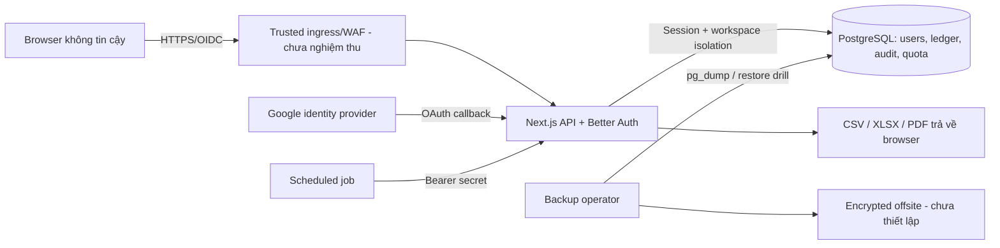

# Finova — Threat model G7

**Ngày rà soát:** 20/10/2026 · **Phạm vi:** Next.js 16 / Better Auth Google OIDC / PostgreSQL ledger / import-export / Docker và CI.

**Trạng thái:** Bản đánh giá từ mã nguồn và kiểm thử phát triển; **chưa nghiệm thu production**. `Implemented` chỉ nói về mã đã hiện diện; `Tested` có chứng cứ test tương ứng; `Partial`, `Open` và `Environment-dependent` không được coi là PASS.

## Tài sản, đường tin cậy và kẻ tấn công

Tài sản cần bảo vệ: Google session và OAuth state, dữ liệu định danh người dùng, `workspaceId`, ví/giao dịch/journal/postings, mục tiêu và dư nợ, tệp nhập-xuất, backup PostgreSQL, secrets OAuth/scheduler và bảng quota. Tác nhân rủi ro: khách chưa xác thực, tài khoản trong workspace khác, browser bị chiếm quyền thực thi, client gửi input sai lệch và người có quyền truy cập hạ tầng/backup.

Trust boundaries: browser → ingress, pre-auth OAuth callback → phiên đăng nhập, session → workspace, service → PostgreSQL, user input → import parsing, API → file download, scheduler → internal API, DB → backup/offsite. `X-Forwarded-For` không phải nguồn IP đáng tin cậy khi chưa có ingress được cấu hình; không mở trực tiếp app nếu sử dụng trusted-client-IP header.

## Risk register

Các mã trong cột **Evidence** là kiểm chứng trong repository hoặc bằng PostgreSQL development; không tương đương kiểm thử xâm nhập độc lập.

| ID / Threat | Asset; attack surface; preconditions | Impact | Existing controls / evidence | Residual risk; required action; status |
| --- | --- | --- | --- | --- |
| TM-01 Account takeover | Google identity/session; OAuth callback; attacker có token/cookie hoặc tài khoản Google bị chiếm | Toàn bộ dữ liệu workspace bị lộ/sửa | Better Auth Google OIDC, không bật password login; `src/server/auth.ts`; OAuth initiation smoke đã có | Chưa test callback, logout, expiry, cookie trên HTTPS bằng hai tài khoản. **Environment-dependent / Open**: authenticated browser E2E, session lifecycle, MFA ở Google theo chính sách |
| TM-02 OAuth request flooding / CSRF | Pre-auth `/api/auth/*`; attacker có thể gửi request/callback | Exhaustion, login denial, state attack | Better Auth state/cookie; `limitAuthRequest` global 600/min + per IP 30/min khi ingress tin cậy; quota PostgreSQL integration PASS | Quota chung có thể bị cạn; reverse proxy/WAF và state callback thực chưa nghiệm thu. **Partial**: rate limits tại edge, kiểm tra origin/callback và logging 429 |
| TM-03 IDOR / cross-workspace read | IDs trong ví, giao dịch, budget, goal, debt/card, import, report filters | Lộ dữ liệu tài chính người khác | `requireContext`, workspace filter và ownership guards tại services; negative tests edit/void/wallet/report/import trong `scripts/integration-check.ts` PASS | Static route guard không chứng minh tất cả service branches. **Partial**: chạy thêm negative HTTP browser tests cho toàn bộ object ID/filter/export; xem `AUTHORIZATION_AUDIT.md` |
| TM-04 Unauthorized write / CSRF | POST/PUT/PATCH qua browser; attacker điều khiển trang khác | Giao dịch ngoài ý muốn | `assertSameOrigin` 100% v1 mutations theo `security:routes`; Better Auth trusted origin; Origin thiếu/sai trả 403 ở runtime smoke trước đây | Chưa thử mọi content-type, cookie trên domain production. **Implemented / Partly tested**: negative browser test cross-site, SameSite/Secure cookies |
| TM-05 XSS và session theft | Note, category, CSV fields, app UI; attacker chèn dữ liệu người dùng | Chạy mã trong browser, đọc data | React escaping theo mặc định; CSP Report-Only trong `next.config.ts`; `nosniff`, frame deny | CSP có `unsafe-inline`, chưa bật enforcement; cần DOM sinks review và browser CSP violations. **Partial / Open** |
| TM-06 SQL injection / parameter tampering | Filter/search/IDs/SQL reconciliation; attacker gửi chuỗi tùy ý | Đọc/sửa data vượt quyền | Prisma query API và `$queryRaw` tagged templates, Zod ở nhiều services; source reconciliation read-only | Cần review toàn bộ raw SQL và input limits; `security:routes` không kiểm tra service SQL. **Partial** |
| TM-07 CSV formula injection | CSV export chứa note/category do người dùng nhập; file mở bằng Excel | Thực thi spreadsheet formula ở máy người tải | `safeCell()` trong `src/server/csv-export.ts` escape text bắt đầu `=,+,-,@`; numeric columns từ formatter tiền | Cần kiểm chứng Excel/LibreOffice cả trường hợp Unicode whitespace và XLSX; **Implemented**, QA client **Open** |
| TM-08 Malicious import / decompression | CSV/XLSX upload parser; người đăng nhập gửi file ác ý | Memory/CPU DoS hoặc bút toán sai | Multipart 6 MiB limit, payload 5 MiB/10k dòng tại service, từ chối formula cell XLSX, staging trước commit, workspace guards, import atomic/idempotent; integration PASS | Fuzz CSV/XLSX, zip-bomb, timeout/CPU budget, malware policy chưa hoàn thành. **Partial** |
| TM-09 Unauthorized export / data cache | `/api/v1/exports/*`, report reads | Lộ dữ liệu qua download/cache | Workspace auth, ownership check wallet/category, private/no-store + nosniff; rate limit export 20/min; negative filters tested | Kiểm tra reverse proxy caches, Content-Disposition, signed artifacts và browser history trên staging. **Partial** |
| TM-10 Scheduler misuse | `/api/internal/recurring`; người ngoài biết hoặc đoán Bearer | Tự động post recurring sai thời điểm | Bearer secret tối thiểu 24 ký tự, `timingSafeEqual`, quota scheduler 10/min, recurring idempotency integration PASS | Secret rotation, ingress restriction và schedule deployment chưa test. **Environment-dependent** |
| TM-11 Replay / duplicate mutation | Idempotency-Key, recurring/import concurrency | Ghi sổ hai lần, sai số dư | Unique keys, Serializable transaction, atomic import/recurring link, retries; PostgreSQL concurrency integration PASS | Stress multi-instance và chaos/network retries chưa có. **Tested locally / Open for distributed load** |
| TM-12 Double-entry / reversal corruption | Journal/postings, sửa/hủy/hoàn tiền; bug hoặc DB write ngoài service | Sai số dư/báo cáo | Deferred journal constraint, `post()` validation, 11 check read-only, transaction rollback probes phát hiện reversal mismatch/VOID active/import link; 53 journals integration PASS | Chưa test mọi loại foreign link và data drift production; chạy đối soát trước/sau deploy theo runbook. **Tested locally** |
| TM-13 Rate-limit bypass/exhaustion | APIs và global OAuth; nhiều node hoặc bot | DoS, quota depletion | PostgreSQL atomic UPSERT; concurrent quota tests PASS; no raw IP/token trong quota keys | Header IP chỉ đáng tin sau WAF, chưa load nhiều instance; quan trắc 429, rate limits tại edge. **Partial** |
| TM-14 Secret leakage | `.env`, Docker image, logs, CI, Git history | Chiếm phiên OAuth/scheduler/database | `.dockerignore`; image baseline xác nhận không chứa `.env`; không in token trong báo cáo | Google Client Secret từng xuất hiện trong hội thoại: **rotate trước production**; secret manager, CI masking, secret scanning và access policy. **Open** |
| TM-15 Backup exposure / destructive restore | PostgreSQL custom dumps, operator và offsite | Rò rỉ toàn bộ tài chính hoặc mất dữ liệu | Backup checksum và restore drill trên DB tạm PASS theo runbook; không reset DB | Chưa có mã hóa/offsite, RPO/RTO, retention và restore test production-like. **Open** |
| TM-16 Dependency supply chain | npm packages, CI Docker build | RCE trong build/runtime hoặc exploit web | `security:audit` ngày 20/10: runtime 0; 5 dev-only High nodes thuộc advisory có theo dõi tới 01/12; immutable lockfile và Docker build baseline | Cần patch upstream, re-audit build image mới và CI remote. **Partial / Open** |
| TM-17 Unauthorized audit/sensitive logs | API exceptions, response payload, audit logs | Leak note/PII/token hoặc mất dấu hoạt động | `failure()` ẩn stack/error details; audit records cho nhiều financial mutations; private no-store responses | Chưa có log redaction review end-to-end, audit coverage cho toàn service, retention/monitoring. **Partial** |

## Nghiệm thu và mức tin cậy

- **Có bằng chứng tại dev (20/10):** `npm run security:routes`, TypeScript/ESLint, 40 unit tests, financial integration 53 journals, security integration quota, `npm run db:reconcile` 11 check với dữ liệu hiện có, rollback corruption probes, npm runtime audit 0.
- **Có bằng chứng lịch sử nhưng phải chạy lại sau source change:** Docker Linux image và HTTP smoke, backup/restore drill, OAuth initiation/browser login chưa xác thực.
- **Release blockers:** authenticated Google callback/session/logout + hai tài khoản; browser financial E2E và accessibility/mobile/PWA; CSP enforcement; multi-instance 10k-scale load test; trusted HTTPS ingress/WAF; offsite encrypted backup + monitoring; CI remote xanh; secret rotation; dependency advisory exception review.

Khi sửa security control, bổ sung test có trạng thái lỗi mong đợi, cập nhật risk register bằng lệnh, môi trường và ngày thực chạy; không chuyển mục `Open` thành `Tested` chỉ dựa vào static inspection.
